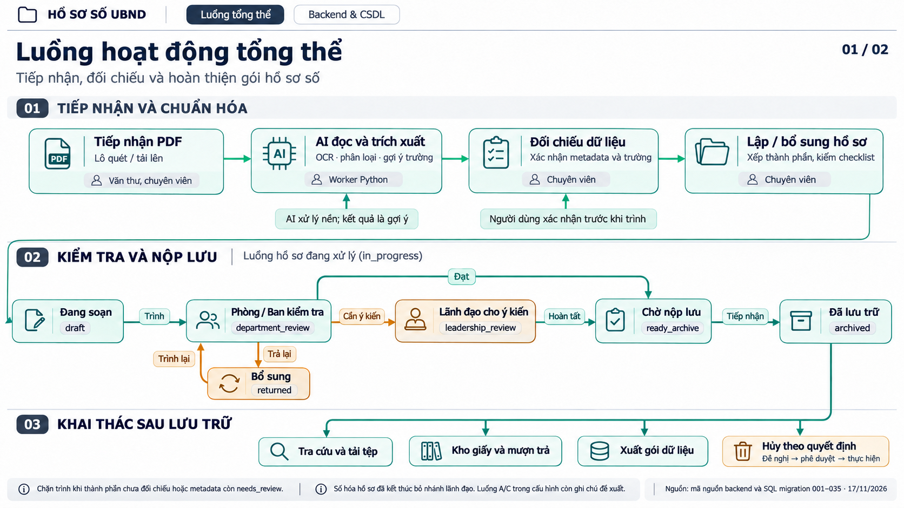
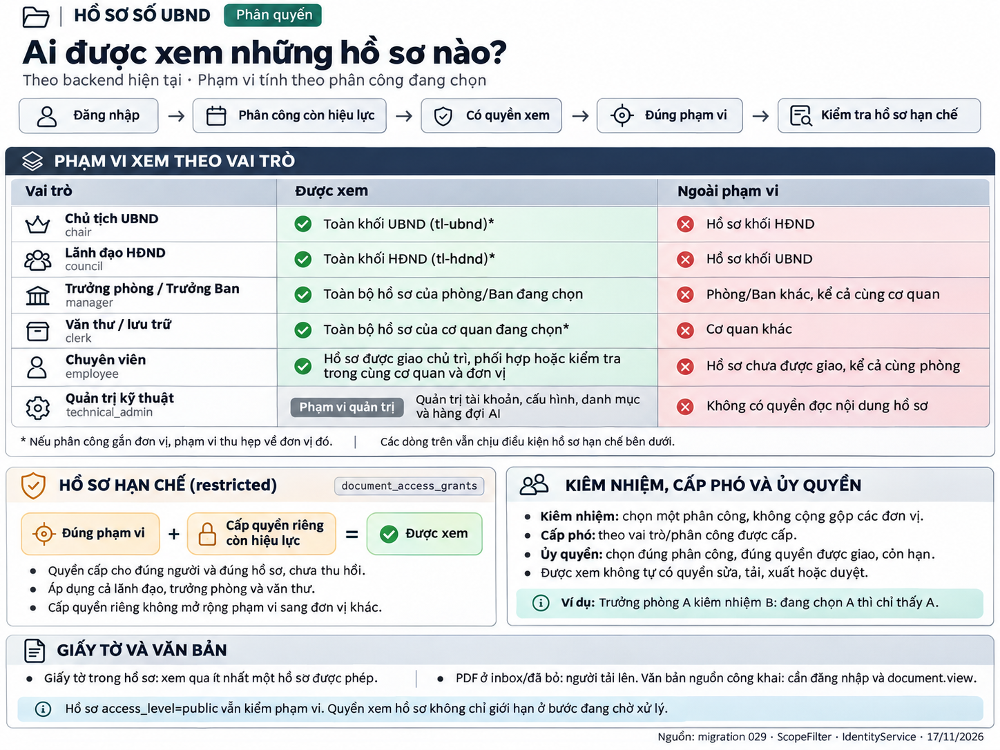
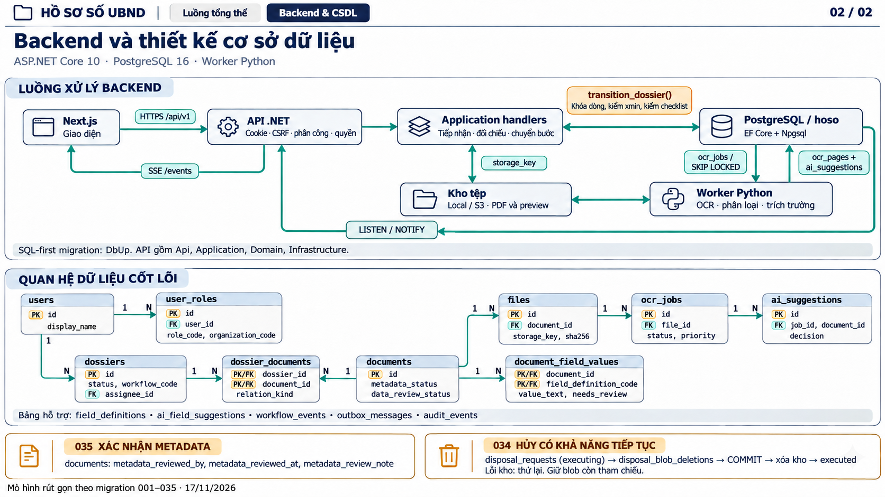
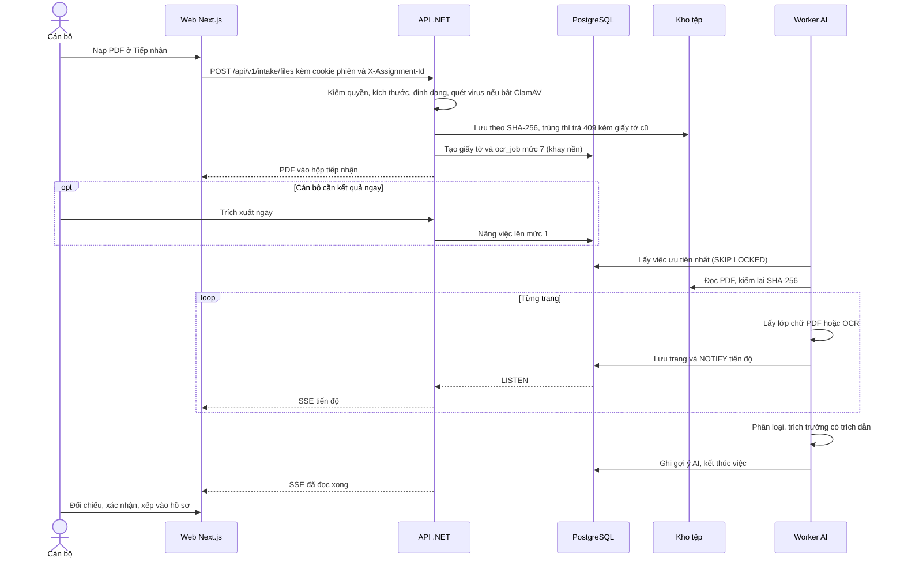
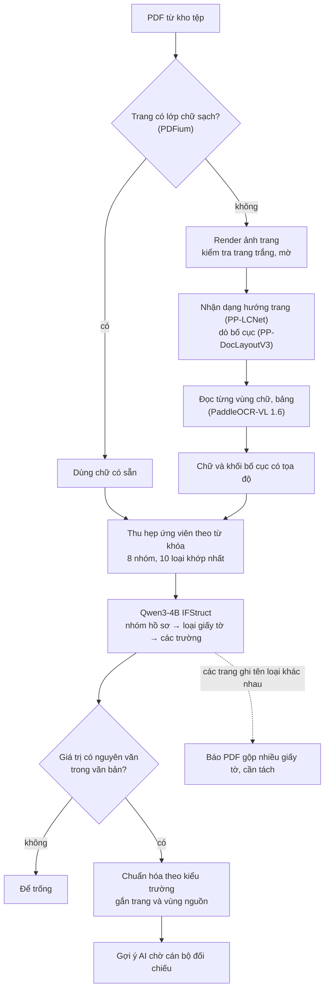

# Hồ sơ số UBND

Hệ thống số hóa và quản lý hồ sơ cho UBND và HĐND phường Từ Liêm (Hà Nội). Cán bộ nạp bản quét PDF, AI chạy tại chỗ đọc và gợi ý dữ liệu, cán bộ đối chiếu rồi xếp giấy tờ vào hồ sơ. Hồ sơ được kiểm tra theo vai trò rồi nộp lưu. Hệ thống còn quản lý bản giấy trong kho, mượn trả và xuất gói dữ liệu bàn giao.

> **Trạng thái:** đang phát triển. Hệ thống đã chạy đủ luồng trên máy dev và môi trường thử, nhưng chưa triển khai cho cơ quan. Mọi người dùng, hồ sơ và giấy tờ trong repo là dữ liệu giả lập hoặc biểu mẫu công khai có ghi nguồn.

## Luồng hoạt động tổng thể



1. **Tiếp nhận và chuẩn hóa.** Văn thư hoặc chuyên viên nạp PDF. Worker AI đọc PDF ở chế độ nền và gợi ý loại giấy tờ cùng các trường dữ liệu. Chuyên viên đối chiếu, xác nhận rồi xếp giấy tờ vào hồ sơ.
2. **Kiểm tra và nộp lưu.** Chuyên viên trình hồ sơ. Trưởng phòng hoặc Trưởng Ban kiểm tra: đạt thì chuyển nộp lưu, cần ý kiến thì trình lãnh đạo, còn thiếu thì trả lại để bổ sung. Văn thư tiếp nhận nộp lưu, sau đó hồ sơ bị khóa sửa.
3. **Khai thác sau lưu trữ.** Tra cứu và tải tệp theo quyền, quản lý kho giấy và mượn trả, xuất gói dữ liệu, hủy tài liệu theo quyết định đã duyệt.

AI chỉ gợi ý. Người dùng phải xác nhận dữ liệu trước khi dùng: hồ sơ không trình được khi còn giấy tờ chưa đối chiếu.

## Chức năng

### Tiếp nhận PDF

- Nạp nhiều PDF cùng lúc, có thanh tiến độ tải. Có thể nạp theo **lô quét** và ghi lỗi ảnh như trang trắng, trang mờ.
- **Chống trùng** theo mã SHA-256: nạp lại tệp đã có thì hệ thống mở giấy tờ cũ. Muốn thay bản quét phải ghi lý do.
- **Hộp tiếp nhận** lọc được theo trạng thái (chờ xếp, đã xếp, đã bỏ) và theo tình trạng AI đọc. Có thể chọn nhiều PDF để xếp vào một hồ sơ hoặc bỏ khỏi hộp, kèm nút hoàn tác.
- PDF mới vào **khay nền** của AI. Nút **"Trích xuất ngay"** đưa PDF lên đầu hàng đợi. Tiến độ đọc từng trang cập nhật trực tiếp trên màn hình.
- Khi máy AI không trả lời hoặc bộ đọc PDF đã dừng, hộp tiếp nhận báo rõ. PDF vẫn nằm trong hàng đợi, không mất, và được đọc tiếp khi máy AI hoạt động trở lại.

### AI đọc và gợi ý

- PDF đã có lớp chữ thì lấy chữ trực tiếp. Bản quét thì kiểm tra chất lượng ảnh rồi OCR bằng **PaddleOCR-VL 1.6**.
- **Qwen3-4B-Instruct-2507 IFStruct** chọn nhóm hồ sơ, loại giấy tờ và trích các trường của loại đó.
- Mỗi giá trị phải có **trích dẫn nguyên văn** trong văn bản, kèm trang và vùng nguồn. Không tìm thấy thì để trống, không tự đoán.
- Hệ thống báo khi một PDF gộp nhiều giấy tờ, để cán bộ tách trước khi lưu.
- Mô hình chạy trong mạng của cơ quan, không gửi dữ liệu lên dịch vụ cloud. Chi tiết ở mục [Kiến trúc](#kiến-trúc).

### Đối chiếu

- Màn hình chia đôi: ảnh trang gốc một bên, các trường dữ liệu một bên. Chọn một trường thì vùng nguồn hiện khung trên ảnh; khung nét đứt nghĩa là vị trí chỉ gần đúng.
- Cán bộ xác nhận loại giấy tờ, thông tin mô tả (số ký hiệu, ngày ban hành, trích yếu…) và từng trường. Giá trị ngày được đưa về dạng `dd/mm/yyyy`.
- Có thể đọc lại trang lỗi, yêu cầu AI gợi ý lại, hoặc **tách** một tệp thành nhiều văn bản.

### Hồ sơ và quy trình

- Tạo hồ sơ theo danh mục nhóm hồ sơ hoặc theo thủ tục hành chính. Mã hồ sơ cấp tự động, ví dụ `UBND-2026-000123`.
- **Danh sách kiểm tra đủ thành phần** theo thủ tục.
- Phân công người chủ trì, phối hợp, kiểm tra kèm hạn xử lý. Hồ sơ sắp đến hạn và quá hạn được đánh dấu màu.
- Có ba quy trình:
  - **Luồng B** (`in_progress`): hồ sơ đang xử lý, như sơ đồ ở trên.
  - **Luồng A** (`digitize_closed`): số hóa hồ sơ giấy đã kết thúc, bỏ bước lãnh đạo cho ý kiến.
  - **Luồng C** (`council`): kỳ họp, thẩm tra, giám sát của HĐND.

  Luồng A và C là đề xuất, còn chờ cơ quan xác nhận.
- Ý kiến khi trả lại, trình lãnh đạo hoặc cho ý kiến phải dài ít nhất 10 ký tự. Mọi bước chuyển đều ghi vào nhật ký xử lý.
- Thông báo trong ứng dụng hiện ngay, gửi qua outbox sau khi bước chuyển đã lưu.

### Việc của tôi

- Danh sách việc đang chờ theo phân công.
- Bảng tổng hợp cho Chủ tịch UBND (theo phòng) và lãnh đạo HĐND (kỳ họp, thẩm tra, giám sát). Bấm vào một con số sẽ mở đúng danh sách hồ sơ tương ứng.
- Ô **Đi nhanh** (Ctrl+K) và phím tắt để di chuyển trong danh sách.

### Tra cứu

- Tìm theo số ký hiệu, trích yếu hoặc nội dung đã OCR. Lọc được theo hình thức văn bản và cơ quan ban hành. Kết quả chỉ gồm văn bản trong phạm vi được xem, và mỗi lần tìm đều ghi nhật ký truy cập.
- Danh mục thủ tục hành chính, kèm thành phần hồ sơ và mẫu biểu.

### Kho bản giấy, nộp lưu và bàn giao

- **Kho bản giấy:** kho, tủ, kệ, hộp có mã QR. Quét mã để tìm vị trí và ghi nhận khi di chuyển hồ sơ.
- **Mượn trả:** đề nghị mượn, duyệt và theo dõi việc trả.
- **Nộp lưu** theo đợt. Một hồ sơ trong đợt lỗi thì cả đợt được hoàn tác.
- **Xuất dữ liệu:** gói bàn giao gồm tệp, dữ liệu mô tả và mã băm danh mục. Tiến độ cập nhật trực tiếp, gói có hạn tải.
- **Đề nghị hủy:** đề nghị, phê duyệt rồi thực hiện. Bước thực hiện xác nhận hai lần và chạy tiếp được nếu bị gián đoạn giữa chừng.

### Quản trị

- Người dùng, phân công có thời hạn, ủy quyền.
- Danh mục nhóm hồ sơ, loại giấy tờ, trường dữ liệu và thời hạn bảo quản.
- **Vận hành:** hàng đợi AI theo mức ưu tiên, trạng thái worker và máy AI, mô hình đang dùng, sao lưu, cài đặt.
- **Nhật ký hệ thống:** ai đã xem, sửa, tải, xuất gì và khi nào. Tra được theo **Mã lỗi** mà người dùng thấy trên màn hình lỗi.

## Phân quyền



- Có 6 vai trò: chuyên viên, văn thư/lưu trữ, trưởng phòng/Trưởng Ban, Chủ tịch UBND, lãnh đạo HĐND, quản trị kỹ thuật. Quản trị kỹ thuật vận hành hệ thống nhưng **không đọc được nội dung hồ sơ**.
- Một người có thể giữ nhiều phân công, ví dụ kiêm nhiệm hoặc nhận ủy quyền. Mỗi request chỉ dùng **một phân công đang chọn**, gửi kèm header `X-Assignment-Id`, nên phạm vi luôn rõ ràng.
- API kiểm tra quyền và phạm vi cho mọi request. Giao diện chỉ ẩn những nút người dùng không có quyền bấm.
- Ma trận quyền đầy đủ theo từng endpoint: [docs/ma-tran-quyen.md](docs/ma-tran-quyen.md). Tệp này sinh từ mã nguồn và có test kiểm tra.

## Kiến trúc



| Thành phần | Thư mục | Vai trò |
|---|---|---|
| Web | [frontend/](frontend/README.md) | Next.js 16, render phía máy chủ. Chuyển tiếp cookie phiên sang API; không giữ token |
| API | [backend/](backend/README.md) | ASP.NET Core .NET 10, modular monolith chia 4 project (Domain, Application, Infrastructure, Api). Phụ trách đăng nhập (cookie phiên, OIDC), quyền, quy trình, REST `/api/v1`, luồng sự kiện SSE `/api/v1/events` và các việc chạy nền (outbox, xuất gói, hủy tài liệu, thu hồi việc AI bị treo) |
| CSDL | [backend/database/migrations/](backend/database/migrations/README.md) | PostgreSQL 16, schema `hoso`. Migration viết bằng SQL, chạy bằng DbUp. Luật chuyển bước nằm ở hàm `transition_dossier` |
| Kho tệp | (cấu hình) | Ổ đĩa local hoặc S3/MinIO. Khóa tệp là mã SHA-256 (`blobs/ab/cd/<sha256>`) |
| Worker AI | [ai-worker/](ai-worker/README.md) | Python. Lấy việc từ bảng `ocr_jobs`, đọc PDF, OCR, phân loại, trích trường rồi ghi kết quả về CSDL |
| Thư viện AI | [document_ai/](document_ai/README.md) | Lời nhắc, bộ thu hẹp ứng viên theo từ khóa, kiểm tra trích dẫn, tải và chuyển đổi mô hình. Worker dùng chung thư viện này |

API và worker **không gọi nhau trực tiếp**. Hai bên chỉ giao tiếp qua hàng đợi trong PostgreSQL (`FOR UPDATE SKIP LOCKED` và `LISTEN/NOTIFY`), nên việc đang chờ không mất khi một bên khởi động lại.

### Đường đi của một PDF



Hàng đợi có 3 mức ưu tiên: **1** là việc người dùng bấm "Trích xuất ngay", **3** là việc có người đang chờ, **7** là khay nền dành cho PDF mới tải lên. Việc nền chạy dở sẽ tự nhường sau mỗi trang khi có việc gấp hơn; các trang đã đọc được giữ lại.

### Pipeline AI



Chọn nơi chạy mô hình bằng biến `HOSO_AI_PROFILE` trong `ai-worker/.env`:

| Hồ sơ | Mô hình chạy ở đâu | Dùng khi |
|---|---|---|
| `mac-mlx` | Ngay trên máy worker (Apple Silicon, MLX 4-bit) | Một máy Mac đủ RAM |
| `ollama` | Máy AI riêng có GPU, chạy Ollama, nối qua mạng riêng mã hóa (Tailscale/WireGuard). OCR bố cục vẫn chạy ở máy worker | Máy chủ không có GPU |
| `fake` | Không dùng mô hình. Kết quả giả, gắn nhãn `[GIẢ LẬP]` | Làm backend hoặc frontend trên máy dev. Bị chặn khi `HOSO_ENV=production` |

Hai hồ sơ `linux-cuda` và `cpu` chưa làm.

## Công nghệ

| Phần | Công nghệ |
|---|---|
| Web | Next.js 16 (App Router, Server Components, Server Actions), React 19, TypeScript strict, Tailwind 4, Vitest, Playwright |
| API | ASP.NET Core .NET 10 LTS, EF Core 10 + Npgsql, DbUp, FluentValidation, Serilog, OpenTelemetry, Scalar (trang tài liệu OpenAPI) |
| CSDL | PostgreSQL 16 (`pg_trgm` cho tìm kiếm, hàm PL/pgSQL cho luật chuyển bước) |
| AI | Python 3.12, PDFium, PaddleOCR-VL 1.6, Qwen3-4B-Instruct-2507 IFStruct; chạy qua MLX hoặc Ollama |
| Hạ tầng dev | `docker-compose.dev.yml` (PostgreSQL, Keycloak, MinIO; Loki, Grafana, GlitchTip ở profile `observability`), GitHub Actions |

## Cấu trúc thư mục

| Thư mục | Nội dung |
|---|---|
| [frontend/](frontend/README.md) | Giao diện web |
| [backend/](backend/README.md) | API .NET, migration CSDL (`backend/database/migrations`), test tích hợp |
| [ai-worker/](ai-worker/README.md) | Worker AI, script cài như dịch vụ (launchd, systemd), công cụ huấn luyện và đo mô hình |
| [document_ai/](document_ai/README.md) | Thư viện AI dùng chung với worker |
| [scripts/](scripts/) | Chạy bộ dev (`dev-up.sh`), kịch bản thử thông luồng, công cụ chuẩn bị dữ liệu |
| [ops/](ops/) | Sao lưu và khôi phục CSDL, xuất repo AI riêng |
| [docs/](docs/README.md) | Tài liệu thiết kế, kế hoạch và trạng thái task |
| [data/](data/) | Danh mục thủ tục hành chính, biểu mẫu công khai, bộ mẫu kiểm thử nhỏ. Bộ dữ liệu lớn nằm ngoài git (xem [.gitignore](.gitignore)) |
| [output/ui-slides/](output/ui-slides/) | Các ảnh sơ đồ dùng trong README |

**Mã thí điểm cũ, không thuộc hệ thống:** `index.html`, `nghiep-vu-vai-tro.html`, `quan-ly-ho-so.html`, `scan-inbox.html`, `sam3-lab.html`, `assets/`, `sam3_service/`, `data/sam3/`, `database/`. Đây là bản thử bằng HTML tĩnh, lưu dữ liệu ở localStorage và tệp JSON. **SAM 3 chỉ có trong công cụ thử nghiệm `sam3-lab.html`; hệ thống hiện tại không dùng SAM 3.** Các tệp này còn giữ lại cho tới khi chuyển xong dữ liệu (giai đoạn P7). Các tệp SQL 001–007 trong `database/` nay là phần nền của `backend/database/migrations`.

## Chạy thử

### Chỉ xem giao diện (không cần backend)

```sh
cd frontend
npm install
cp .env.example .env.local     # HOSO_MOCK=1: dữ liệu giả lập trong trình duyệt
npm run dev                    # http://localhost:3000, chọn một tài khoản mẫu theo vai trò
```

### Cả hệ thống trên máy dev

Cần .NET SDK 10 trở lên, Node.js 22, Python 3.12 và PostgreSQL 16. Các bước dưới đây đã chạy trên macOS.

```sh
# 1. PostgreSQL: dùng bản cài sẵn, hoặc Docker
docker compose -f docker-compose.dev.yml up -d postgres

# 2. Tạo schema trên CSDL hoso_dev MỚI (lệnh này nạp cả dữ liệu giả lập *_optional.sql)
cd backend && dotnet run --project src/HoSoSo.Api -- migrate && cd ..
#    CSDL đã có dữ liệu thì dùng backend/scripts/migrate-hoso-dev.sh, xem CONTRIBUTING.md

# 3. Cho hai role CSDL đăng nhập bằng mật khẩu dev và tạo ai-worker/.env
HOSO_DEV_PG_ADMIN=<siêu người dùng PostgreSQL> scripts/dev-up.sh init

# 4. Chọn AI: giả lập (không cần mô hình) hoặc thật
scripts/dev-up.sh ai fake
#    scripts/dev-up.sh ai real                               Mac Apple Silicon, cài mô hình trước bằng scripts/setup-document-ai.sh
#    scripts/dev-up.sh ai ollama http://<IP máy AI>:11434    mô hình chạy ở máy khác

# 5. Chạy API (5080), worker (9108) và web (3000)
scripts/dev-up.sh start
scripts/dev-up.sh status
```

Mở http://localhost:3000 và đăng nhập bằng `dev_admin`. Tài khoản này có 18 phân công để thử mọi vai trò; đổi vai trò ở ô **Vai trò** trên thanh trên cùng. Muốn có tài khoản riêng cho từng vai trò thì chạy `backend/scripts/seed-dev-accounts.sh --apply`. Tài liệu API: http://localhost:5080/docs.

Mật khẩu trong `docker-compose.dev.yml`, `appsettings.Development.json` và `scripts/dev-up.sh` chỉ dùng cho máy dev. Vận hành, AI, sao lưu và cách xử lý sự cố thường gặp: [docs/08-so-tay-van-hanh.md](docs/08-so-tay-van-hanh.md).

## Kiểm thử

| Phần | Lệnh |
|---|---|
| Web | `cd frontend && npm run typecheck && npm run lint && npm test` |
| Web E2E, giả lập | `cd frontend && npx playwright test` |
| API | `cd backend && HOSO_TEST_PG="Host=127.0.0.1;Port=5432;Username=<bạn>" dotnet test --solution HoSoSo.slnx` (bỏ `HOSO_TEST_PG` thì Testcontainers tự dựng PostgreSQL) |
| Worker AI | `cd ai-worker && PYTHONPATH=src:.. python -m pytest -q` (dùng AI giả, không cần mô hình) |
| E2E tích hợp | `scripts/dev-up.sh start`, rồi `cd frontend && E2E_MODE=integration npx playwright test` |
| Thông luồng nghiệp vụ | `python3 scripts/smoke-nghiep-vu.py` (chạy luồng A, B, C, lô quét, ủy quyền, mỗi bước bằng đúng tài khoản) |

Quy ước nhánh, commit, migration và định nghĩa hoàn thành: [CONTRIBUTING.md](CONTRIBUTING.md).

## Nguyên tắc dữ liệu

1. Ảnh quét giữ nguyên bản. OCR chỉ là lớp hỗ trợ và có thể sai.
2. AI không bịa giá trị: không thấy thì để trống. Mọi giá trị đều kèm nguồn và cần người đối chiếu.
3. Thông tin mâu thuẫn được lưu lại đủ, hệ thống không tự chọn một giá trị.
4. Nhật ký truy cập và nhật ký thay đổi chỉ được ghi thêm, không sửa, không xóa. Log không chứa nội dung giấy tờ.
5. Dữ liệu được xử lý tại chỗ, không gửi lên cloud khi cơ quan chưa chấp thuận.
6. Nội dung tài liệu là dữ liệu, không phải chỉ dẫn cho mô hình ngôn ngữ.

## Chưa làm

- **Triển khai thật:** chưa có Dockerfile, compose production, reverse proxy có TLS hay đăng nhập SSO có MFA. Chưa kiểm với Keycloak, MinIO/S3 và ClamAV thật.
- **AI:** độ chính xác mới đo trên dữ liệu giả lập, chưa đo trên giấy tờ thật. Chưa có hồ sơ chạy mô hình trên Linux (CUDA, CPU).
- **Nghiệp vụ:** luồng A và C cần cơ quan xác nhận. Kết nối hệ thống một cửa, quản lý văn bản và kho lưu trữ số để dành cho giai đoạn sau.

Trạng thái từng task: [docs/04-ke-hoach-task.md](docs/04-ke-hoach-task.md).

## Tài liệu

| Tệp | Nội dung |
|---|---|
| [docs/01-tong-quan-du-an.md](docs/01-tong-quan-du-an.md) | Mục tiêu, vai trò, ba luồng nghiệp vụ, nguyên tắc dữ liệu |
| [docs/02-kien-truc-server.md](docs/02-kien-truc-server.md) | Quyết định kiến trúc, sơ đồ C4, module, danh sách API |
| [docs/03-thiet-ke-csdl.md](docs/03-thiet-ke-csdl.md) | Thiết kế CSDL: bảng, view, hàm, chỉ mục |
| [docs/04-ke-hoach-task.md](docs/04-ke-hoach-task.md) | Kế hoạch, task và trạng thái thực tế |
| [docs/05-bao-mat.md](docs/05-bao-mat.md) | Phương án bảo mật |
| [docs/06-log-va-giam-sat.md](docs/06-log-va-giam-sat.md) | Log, báo lỗi, giám sát |
| [docs/07-khung-giao-dien.md](docs/07-khung-giao-dien.md) | Bản đồ đường dẫn và quy ước giao diện |
| [docs/08-so-tay-van-hanh.md](docs/08-so-tay-van-hanh.md) | Sổ tay vận hành máy dev |
| [docs/ma-tran-quyen.md](docs/ma-tran-quyen.md) | Ma trận quyền theo endpoint |
