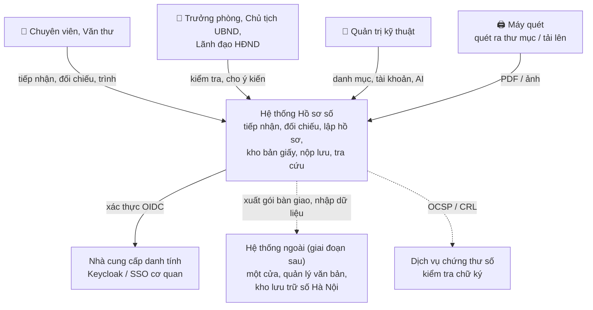
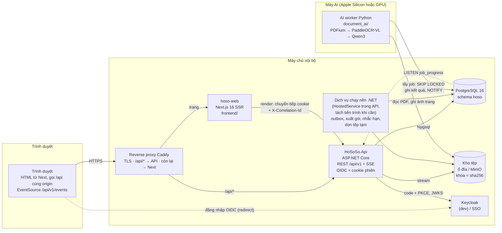
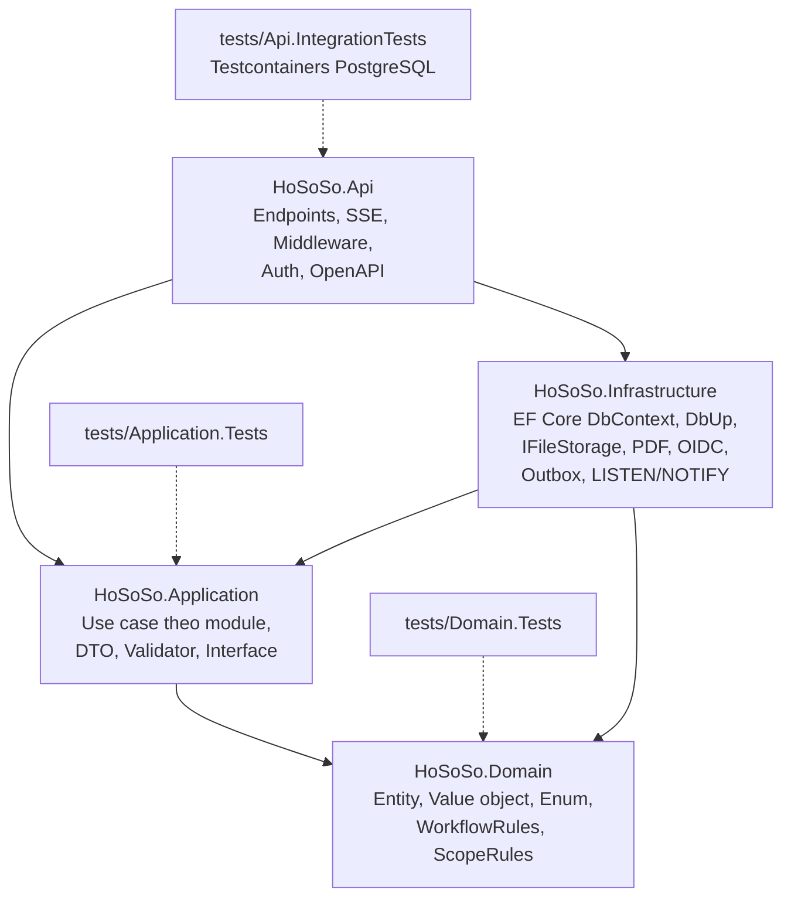
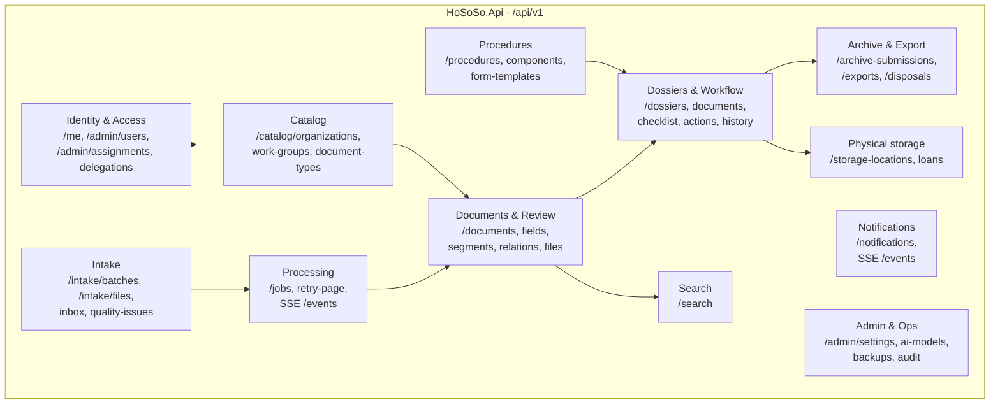
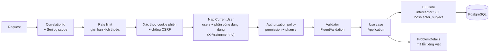
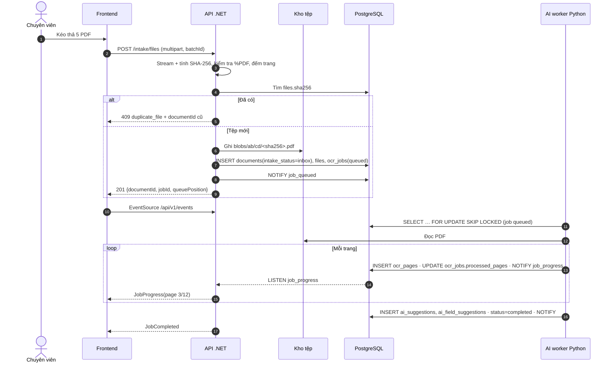
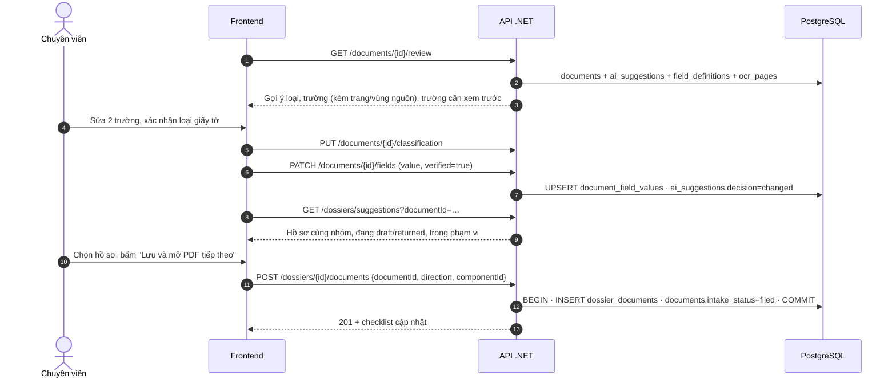
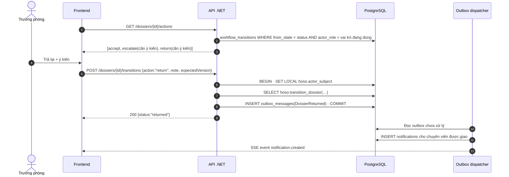
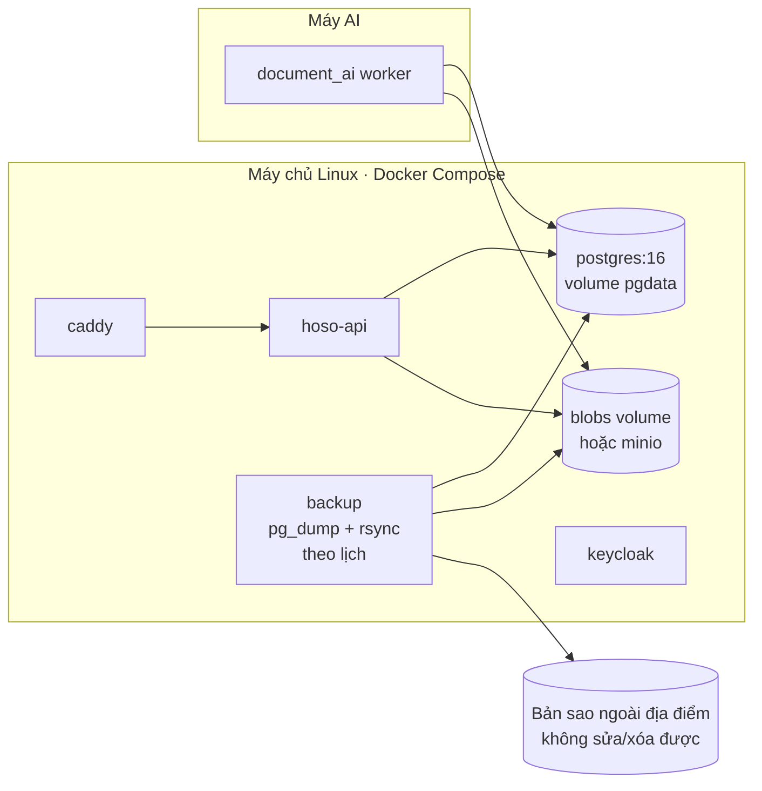

# 02 · Thiết kế kiến trúc server

Backend viết bằng **ASP.NET Core (.NET 10 LTS)**, cơ sở dữ liệu **PostgreSQL 16**, frontend **Next.js 16 (React 19, render phía máy chủ)**. Pipeline AI giữ nguyên bằng Python (`document_ai/`) vì PaddleOCR-VL và Qwen chạy qua MLX, không có bản .NET tương đương. Hai bên nói chuyện qua hàng đợi trong PostgreSQL, không gọi HTTP trực tiếp.

Sơ đồ viết bằng Mermaid; xem trong VS Code với extension *Markdown Preview Mermaid Support* hoặc trên GitHub/GitLab.

---

## 1. Quyết định kiến trúc chính

| # | Quyết định | Lý do | Phương án đã cân nhắc |
|---|---|---|---|
| ADR-01 | **Modular monolith** một API .NET, chia module theo nghiệp vụ | Đội nhỏ, một cơ quan, 5–50 người dùng đồng thời. Tách microservice chỉ thêm vận hành | Microservices |
| ADR-02 | **Clean Architecture** 4 project: Domain, Application, Infrastructure, Api | Quy tắc nghiệp vụ (luồng chuyển bước, phạm vi) kiểm thử được mà không cần DB | Một project duy nhất |
| ADR-03 | **SQL-first migration** bằng DbUp; EF Core chỉ để truy vấn, không sinh migration | Schema hiện có nhiều CHECK, trigger, hàm PL/pgSQL; viết bằng SQL rõ hơn. Giữ được 001–007 làm baseline | EF Core code-first |
| ADR-04 | **Hàng đợi AI trong PostgreSQL** (`ocr_jobs` + `FOR UPDATE SKIP LOCKED` + `LISTEN/NOTIFY`) | Không thêm RabbitMQ/Redis; job sống sót khi khởi động lại; Python và .NET cùng đọc được | RabbitMQ, gọi HTTP sang FastAPI |
| ADR-05 | **Kho tệp đánh địa chỉ theo SHA-256** qua `IFileStorage` (ổ đĩa local hoặc S3/MinIO) | Chống trùng, kiểm tra toàn vẹn, không để nhị phân trong DB | Lưu bytea trong PostgreSQL |
| ADR-06 | **API .NET giữ phiên** (cập nhật 16/11/2026): đăng nhập OIDC (Keycloak khi dev, SSO cơ quan khi triển khai) do API xử lý, phiên là cookie httpOnly `__Host-hoso`; Next.js chỉ chuyển tiếp cookie khi render phía máy chủ | Token IdP không ra trình duyệt hay Next; tải PDF 100 MB đi thẳng vào API; kiểm tra quyền chỉ ở một nơi | Next.js giữ token (Auth.js), SPA giữ token trong bộ nhớ |
| ADR-07 | **Phân quyền ở API**, mỗi request mang một *phân công đang dùng* (`X-Assignment-Id`) | Một người có thể vừa là chuyên viên vừa kiêm văn thư; phạm vi phải rõ từng thao tác | Gộp mọi quyền của người dùng |
| ADR-08 | **Server-Sent Events** `GET /api/v1/events` đẩy tiến độ đọc PDF và thông báo (cập nhật 16/11/2026) | Chỉ cần đẩy một chiều; đi qua reverse proxy như HTTP thường, dùng cookie phiên sẵn có, không cần thư viện client | SignalR (WebSocket), polling |
| ADR-09 | **Outbox pattern** cho thông báo và việc chạy nền | Gửi thông báo chỉ khi transaction chuyển bước đã commit | Gửi ngay trong request |
| ADR-10 | Không dùng MediatR, AutoMapper | MediatR đã chuyển giấy phép thương mại; mapping viết tay rõ hơn | — |
| ADR-11 | **Next.js render phía máy chủ** (App Router, Server Components, Server Actions), tắt `cacheComponents` | Trang đầu hiện ngay có dữ liệu, ít JavaScript ở trình duyệt; tắt cache tránh lộ dữ liệu người này cho người khác | SPA thuần (Vite), Blazor |
| ADR-12 | **Giữ .NET 10 LTS** (hỗ trợ tới 11/2028), không lên .NET 11 | Npgsql EF Core chưa hỗ trợ EF Core 11 (tra ngày 16/11/2026); hệ thống cơ quan cần bản hỗ trợ dài hạn | .NET 11 (STS) |

Thư viện dự kiến (đều MIT/Apache): Npgsql + EF Core, DbUp, FluentValidation, Serilog, OpenTelemetry, Scalar (UI OpenAPI), PdfPig (đọc PDF), PDFtoImage/PDFium (ảnh xem trước), QRCoder, Testcontainers, xUnit, Bogus.

---

## 2. Sơ đồ ngữ cảnh (C4 · mức 1)



---

## 3. Sơ đồ container (C4 · mức 2)



**Ghi chú triển khai AI:** mô hình hiện chạy qua MLX trên Mac M4. Nếu máy chủ cơ quan là Linux, worker phải đổi sang backend CUDA hoặc CPU của PaddleOCR; giao tiếp qua DB giữ nguyên nên API không phải sửa.

---

## 4. Cấu trúc solution .NET



```
backend/
├─ HoSoSo.slnx                    # định dạng solution mới của .NET 10
├─ global.json                    # ghim SDK 10.0.x
├─ Directory.Build.props          # net10.0, Nullable; CI coi cảnh báo là lỗi
├─ Directory.Packages.props       # phiên bản gói tập trung
├─ database/
│  ├─ migrations/                 # 001…007 (baseline, DB-01) + 008… mới, chạy bằng DbUp
│  └─ seeds/
├─ src/
│  ├─ HoSoSo.Domain/              # Identity/ (quyền, vai trò) · Workflow/ (luật chuyển bước) · Catalog/ …
│  ├─ HoSoSo.Application/         # Common/ (ICurrentUser, IClock, AppException, ErrorCodes) · Intake/ (IFileStorage) …
│  ├─ HoSoSo.Infrastructure/      # Persistence/ (DbContext, cấu hình bảng, interceptor người thao tác)
│  │                              # Migrations/ (DbUp) · Storage/ (LocalFileStorage) · Health/
│  └─ HoSoSo.Api/
│     ├─ Program.cs               # thứ tự middleware, lệnh "migrate"
│     ├─ Endpoints/               # một tệp mỗi module; endpoint chưa làm trả 501 kèm mã task
│     ├─ Security/                # cookie + OIDC, policy quyền động, tài khoản dev
│     ├─ Middleware/              # mã tương quan, CSRF, header bảo mật
│     ├─ Errors/                  # GlobalExceptionHandler → ProblemDetails + errorId
│     └─ Observability/           # Serilog JSON, OpenTelemetry, GlitchTip
└─ tests/
   ├─ HoSoSo.Domain.Tests/        # luật chuyển bước, quyền mặc định
   ├─ HoSoSo.Application.Tests/
   └─ HoSoSo.Api.IntegrationTests/ # bảo mật: 401, 403, CSRF, open redirect
```

---

## 5. Module nghiệp vụ



| Module | Trách nhiệm | Bảng chính (xem `03`) |
|---|---|---|
| Identity & Access | Người dùng, phân công, ủy quyền, quyền tài liệu hạn chế, nhật ký truy cập | `users`, `user_roles`, `delegations`, `document_access_grants`, `access_events` |
| Catalog | Tổ chức, đầu mối, nhóm hồ sơ, loại giấy tờ, trường, thời hạn bảo quản | `organizations`, `departments`, `work_groups`, `document_types`, `field_definitions`, `retention_rules` |
| Procedures | Danh mục thủ tục hành chính, thành phần hồ sơ, mẫu biểu | `procedures`, `procedure_components`, `form_templates` |
| Intake | Lô quét, tải tệp, chống trùng, hộp tiếp nhận, kiểm tra ảnh | `scan_batches`, `files`, `page_images`, `quality_issues` |
| Processing | Hàng đợi AI, tiến độ, kết quả từng trang, gợi ý | `ocr_jobs`, `ocr_pages`, `ai_suggestions`, `ai_field_suggestions`, `ai_models` |
| Documents & Review | Metadata, phân loại, trường, đối chiếu, tách văn bản, liên kết, chữ ký | `documents`, `document_field_values`, `document_segments`, `document_relations`, `file_signatures` |
| Dossiers & Workflow | Hồ sơ, thành phần, phân công, kiểm tra đủ, chuyển bước, lịch sử | `dossiers`, `dossier_documents`, `dossier_assignments`, `workflow_*` |
| Search | Tìm theo số, trích yếu, toàn văn OCR, có áp phạm vi | `documents`, `ocr_pages` (GIN) |
| Physical storage | Kho, tủ, kệ, hộp, mã QR, di chuyển, mượn trả | `storage_locations`, `dossier_location_moves`, `loans` |
| Archive & Export | Nộp lưu theo đợt, xuất gói bàn giao, đề nghị hủy có duyệt | `archive_submissions`, `export_packages`, `disposal_requests` |
| Notifications | Thông báo trong ứng dụng, đẩy realtime | `notifications`, `outbox_messages` |
| Admin & Ops | Cấu hình, mô hình AI, sao lưu, xem nhật ký | `system_settings`, `ai_models`, `backup_runs`, `audit_events` |

---

## 6. Đường đi của một request



**Phạm vi** áp ở Application, không chỉ ở UI: mọi truy vấn hồ sơ và giấy tờ đi qua `IScopeFilter` (cùng quy tắc với hàm SQL `scope_matches`). Tải tệp, xem trước, tìm kiếm, xuất đều kiểm tra phạm vi và ghi `access_events`.

**Mã lỗi thống nhất** (`type` trong ProblemDetails):

| HTTP | Mã | Khi nào |
|---|---|---|
| 400 | `validation_failed` | Dữ liệu sai định dạng |
| 401 | `unauthenticated` | Chưa đăng nhập, token hết hạn |
| 403 | `out_of_scope` | Hồ sơ ngoài phạm vi phân công |
| 404 | `not_found` | Không có, hoặc có nhưng ngoài phạm vi đọc (không lộ sự tồn tại) |
| 409 | `workflow_conflict` | Hành động không hợp lệ ở bước hiện tại, xung đột phiên bản |
| 409 | `duplicate_file` | Tệp cùng SHA-256 đã có; trả kèm id giấy tờ cũ |
| 422 | `dossier_incomplete` | Thiếu thành phần bắt buộc hoặc còn trường chưa đối chiếu; trả danh sách thiếu |
| 422 | `note_required` | Hành động cần ý kiến từ 10 ký tự |

---

## 7. Luồng xử lý chính (sequence)

### 7.1 Tải PDF lên và đọc bằng AI



### 7.2 Đối chiếu và xếp vào hồ sơ



### 7.3 Chuyển bước hồ sơ



---

## 8. Danh sách API (v1)

Mọi đường dẫn có tiền tố `/api/v1`. Danh sách đầy đủ sinh từ OpenAPI tại `/openapi/v1.json`, xem bằng Scalar tại `/docs` (chỉ bật ở môi trường dev).

| Module | Phương thức & đường dẫn | Mô tả | Quyền |
|---|---|---|---|
| Identity | `GET /me` | Hồ sơ, các phân công còn hiệu lực, quyền | Đăng nhập |
| | `GET/POST/PATCH /admin/users`, `/admin/assignments`, `/admin/delegations` | Quản lý người dùng, phân công, ủy quyền | `admin.users` |
| Catalog | `GET /catalog/organizations`, `/departments`, `/work-groups`, `/work-groups/{code}/document-types` | Danh mục, có ETag | Đăng nhập |
| | `POST/PATCH /admin/catalog/...` | Sửa danh mục, đánh dấu đã xác nhận | `catalog.manage` |
| Procedures | `GET /procedures?q=&domain=&status=`, `GET /procedures/{id}` | Tra thủ tục, thành phần, mẫu | Đăng nhập |
| | `GET /form-templates/{id}/file` | Tải mẫu biểu | Đăng nhập |
| Intake | `POST /intake/batches`, `GET /intake/batches/{id}`, `POST /intake/batches/{id}/close` | Lô quét | `intake.manage` |
| | `POST /intake/files` | Tải tệp (multipart, tối đa 200 MB, cấu hình được) | `intake.upload` |
| | `GET /intake/inbox?status=inbox\|filed\|discarded&limit=50&cursor=` | Hộp tiếp nhận, trả `{items,nextCursor}` | `intake.upload` |
| | `POST /intake/documents/{id}/discard`, `/restore` | Bỏ, hoàn tác | `intake.upload` |
| | `GET/POST/PATCH /quality-issues` | Lỗi ảnh, quét lại | `intake.qc` |
| Processing | `GET /jobs/{id}`, `POST /jobs/{id}/cancel`, `POST /jobs/{id}/pages/{n}/retry` | Tiến độ, hủy, đọc lại trang | Chủ job hoặc `processing.manage` |
| | `GET /events` (SSE) | Tiến độ đọc PDF và thông báo realtime | Đăng nhập |
| Documents | `GET /documents/{id}`, `GET /documents/{id}/review` | Chi tiết, dữ liệu đối chiếu | Phạm vi |
| | `PUT /documents/{id}/classification`, `PUT /documents/{id}/metadata`, `PATCH /documents/{id}/fields`, `POST /documents/{id}/verify` | Đối chiếu | `document.edit` |
| | `GET/POST /documents/{id}/segments`, `POST /segments/{id}/confirm` | Tách văn bản | `document.edit` |
| | `POST /documents/{id}/relations` | Liên kết phụ lục, thay thế, trả lời | `document.edit` |
| | `GET /files/{id}/content` (Range), `GET /files/{id}/pages/{n}/preview` | Xem, tải tệp | `document.view` / `document.download` |
| Dossiers | `GET /dossiers?status=&workGroup=&dept=&year=&due=&q=&page=` | Danh sách theo phạm vi | `dossier.read` |
| | `POST /dossiers`, `PATCH /dossiers/{id}` | Tạo, sửa thông tin | `dossier.prepare` |
| | `POST/DELETE/PATCH /dossiers/{id}/documents` | Thêm, gỡ, sắp xếp giấy tờ | `dossier.prepare` |
| | `GET /dossiers/{id}/checklist` | Đủ / thiếu thành phần | `dossier.read` |
| | `PUT /dossiers/{id}/assignment` | Giao chuyên viên, hạn | `dossier.assign` |
| | `GET /dossiers/{id}/actions`, `POST /dossiers/{id}/transitions` | Thao tác được phép, chuyển bước | Theo `workflow_transitions` |
| | `GET /dossiers/{id}/history` | Nhật ký | `dossier.read` |
| | `GET /dossiers/suggestions?documentId=` | Hồ sơ gợi ý khi xếp giấy tờ | `dossier.prepare` |
| Workspace | `GET /workspace/summary`, `GET /workspace/queue` | Màn “Việc của tôi” | Đăng nhập |
| Search | `GET /search?q=&type=&from=&to=&org=` | Tìm metadata + toàn văn | `document.view` |
| Storage | `GET/POST/PATCH /storage-locations`, `GET /storage-locations/{id}/qr` | Kho, nhãn QR | `storage.manage` |
| | `PUT /dossiers/{id}/location` | Đặt vị trí bản giấy | `storage.manage` |
| | `POST /loans`, `/loans/{id}/approve`, `/lend`, `/return` | Mượn trả | `loan.*` |
| Archive | `POST /archive-submissions`, `/submit`, `/receive`, `/return` | Nộp lưu theo đợt | `dossier.archive` |
| | `POST /exports`, `GET /exports/{id}`, `GET /exports/{id}/file` | Xuất gói bàn giao | `export.create` |
| | `POST /disposals`, `/approve`, `/reject`, `/execute` | Đề nghị hủy; thực hiện có trạng thái `executing` và thử lại bền vững | `disposal.*` |
| Notifications | `GET /notifications`, `POST /notifications/{id}/read` | Thông báo (realtime qua `GET /events`) | Đăng nhập |
| Admin | `GET /admin/ai/status`, `GET/PATCH /admin/settings`, `GET /admin/audit`, `GET /admin/backups` | Vận hành | `technical_admin` |
| Health | `GET /health/live`, `GET /health/ready` | Kiểm tra sống, DB, kho tệp | Không cần đăng nhập, chỉ mạng nội bộ |

---

## 9. Bảo mật

Phương án đầy đủ: [05-bao-mat.md](05-bao-mat.md). Ghi log và báo lỗi: [06-log-va-giam-sat.md](06-log-va-giam-sat.md).

- Chỉ HTTPS; HSTS ở Caddy; CSP có nonce cho trang Next, `default-src 'none'` cho phản hồi API.
- Phiên là cookie `__Host-hoso` httpOnly, Secure, SameSite=Lax; ghi dữ liệu cần header `X-CSRF` hoặc Origin trùng; quản trị và lãnh đạo bắt buộc xác thực hai lớp ở IdP.
- Kiểm tra kiểu tệp bằng magic bytes, giới hạn kích thước, tên tệp không dùng làm đường dẫn; tùy chọn quét virus bằng ClamAV.
- Phân quyền ở server cho **đọc, tải, in, xuất, tìm kiếm**, không chỉ ẩn nút.
- Tài khoản DB của API không có quyền `UPDATE/DELETE` trên `workflow_events`, `audit_events`, `access_events`; tài khoản migration tách riêng.
- Worker AI dùng tài khoản DB riêng, chỉ được ghi các bảng xử lý.
- Nội dung OCR đưa vào LLM luôn được bọc là dữ liệu (giữ prompt hiện có trong `classify.py`), đầu ra bị ràng theo bộ trường.
- Không ghi nội dung giấy tờ, số định danh cá nhân vào log.

## 10. Vận hành



- Cấu hình qua biến môi trường + `appsettings.{Environment}.json`; bí mật không nằm trong repo.
- Log JSON (Serilog), trace/metric OpenTelemetry; theo dõi: độ dài hàng đợi AI, thời gian đọc/trang, lỗi 5xx, dung lượng kho.
- Sao lưu: `pg_dump` hằng ngày + WAL archiving; đồng bộ kho tệp; mỗi lần chạy ghi `backup_runs`; diễn tập khôi phục hằng quý có biên bản.
