# 03 · Thiết kế cơ sở dữ liệu

PostgreSQL 16, schema `hoso`. Thiết kế **giữ nguyên 23 bảng** trong `database/001_schema.sql` (đã có kiểm thử) và mở rộng thêm để phủ đủ 12 nhóm chức năng trong đề xuất. Tổng cộng **60 bảng** (23 hiện có + 37 mới), chia 10 nhóm.

Ký hiệu trong sơ đồ:

- Bảng có `<<mới>>`: bảng thêm mới.
- Cột có `★`: cột thêm vào bảng hiện có.
- `PK`, `FK`, `UQ`: khóa chính, khóa ngoại, duy nhất.

---

## 1. Quy ước

| Hạng mục | Quy ước |
|---|---|
| Tên | `snake_case`, bảng số nhiều, tiếng Anh; nhãn tiếng Việt nằm trong dữ liệu |
| Khóa chính | Danh mục dùng mã `text` (`U15`, `ht`, `tl-ubnd`); thực thể nghiệp vụ dùng `uuid` (`gen_random_uuid()`); nhật ký dùng `bigint identity` |
| Thời gian | `timestamptz` cho thời điểm; `date` cho ngày nghiệp vụ (ngày ban hành, hạn) |
| Giá trị liệt kê | `text` + `CHECK (... IN (...))`; ánh xạ sang `enum` C# bằng value converter. Không dùng kiểu `ENUM` của PostgreSQL vì khó đổi |
| Tiền tệ, số đo | Lưu chuỗi gốc trong `value_text`; giá trị chuẩn hóa ở cột riêng khi cần |
| Xóa | Không xóa cứng dữ liệu nghiệp vụ. Dùng trạng thái (`discarded`, `revoked_at`, `ended_at`). Hủy tài liệu chỉ qua `disposal_requests` |
| Khóa lạc quan | Bảng được sửa đồng thời (`dossiers`, `documents`, `document_field_values`) có cột `row_version` ★ dùng `xmin` của PostgreSQL qua EF Core |
| Nhật ký | `audit_events`, `workflow_events`, `access_events` chỉ ghi thêm (trigger chặn sửa, xóa) |
| Extension | `pgcrypto` (đã có), `unaccent`, `pg_trgm` cho tìm kiếm tiếng Việt không dấu |

---

## 2. Sơ đồ tổng quan

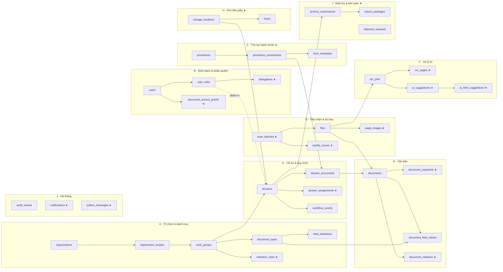

---

## 3. Nhóm A · Tổ chức & danh mục

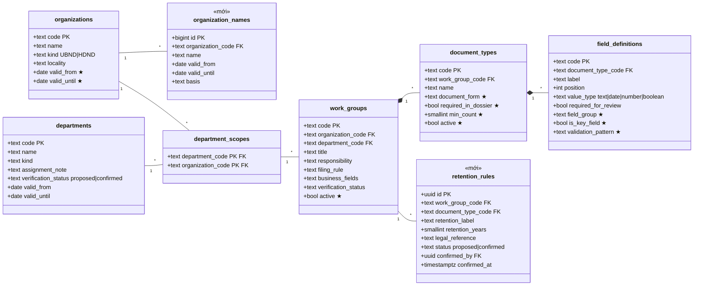

| Bảng | Ghi chú thiết kế |
|---|---|
| `organization_names` | Tên cơ quan theo thời kỳ (trước/sau sắp xếp 2025). Giấy tờ giữ tên tại thời điểm lập; tra cứu theo tên cũ vẫn ra |
| `document_types.document_form` | Hình thức (Quyết định, Công văn…) để đối chiếu với `documents.document_form` mà AI đọc |
| `document_types.required_in_dossier`, `min_count` | Dùng cho danh sách kiểm tra đủ thành phần. Mặc định `false` vì danh mục hiện là đề xuất |
| `field_definitions.is_key_field` | Trường quan trọng (người, định danh, số tiền, số thửa, số/ký hiệu) bắt buộc người kiểm tra xác nhận |
| `retention_rules` | Chỉ lưu khi cơ quan xác nhận (`status=confirmed`); không tự đặt thời hạn |

---

## 4. Nhóm B · Định danh & phân quyền

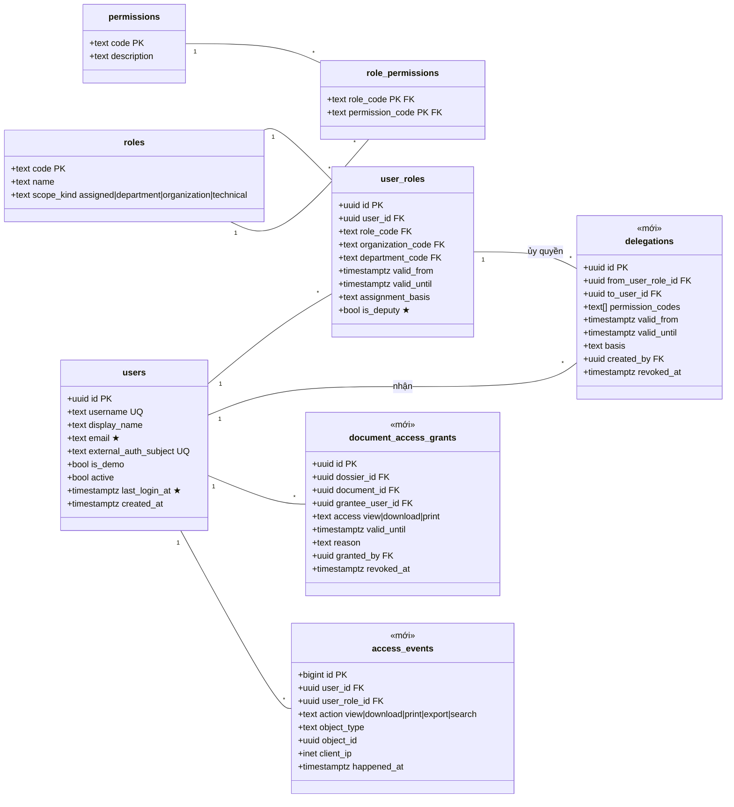

**Quyền bổ sung** (seed vào `permissions`): `document.view`, `document.download`, `document.print`, `document.edit`, `intake.upload`, `intake.manage`, `intake.qc`, `processing.manage`, `catalog.manage`, `storage.manage`, `loan.request`, `loan.approve`, `export.create`, `disposal.request`, `disposal.approve`, `admin.users`, `admin.settings`.

**Quy tắc phạm vi** (mở rộng `scope_matches`):

1. Phân công còn hiệu lực (`valid_from ≤ now < valid_until`) và người dùng `active`.
2. Hoặc ủy quyền còn hiệu lực trỏ tới phân công đó, chỉ với `permission_codes` được ủy.
3. Hồ sơ `access_level = restricted` chỉ đọc được khi có thêm `document_access_grants` còn hiệu lực.
4. `technical_admin` không đọc nội dung hồ sơ.

`access_events` phân vùng theo tháng (`PARTITION BY RANGE (happened_at)`) vì tăng nhanh.

---

## 5. Nhóm C · Thủ tục hành chính (mới)

Nạp từ `data/official-forms/*.json` bằng script nhập có thể chạy lại.

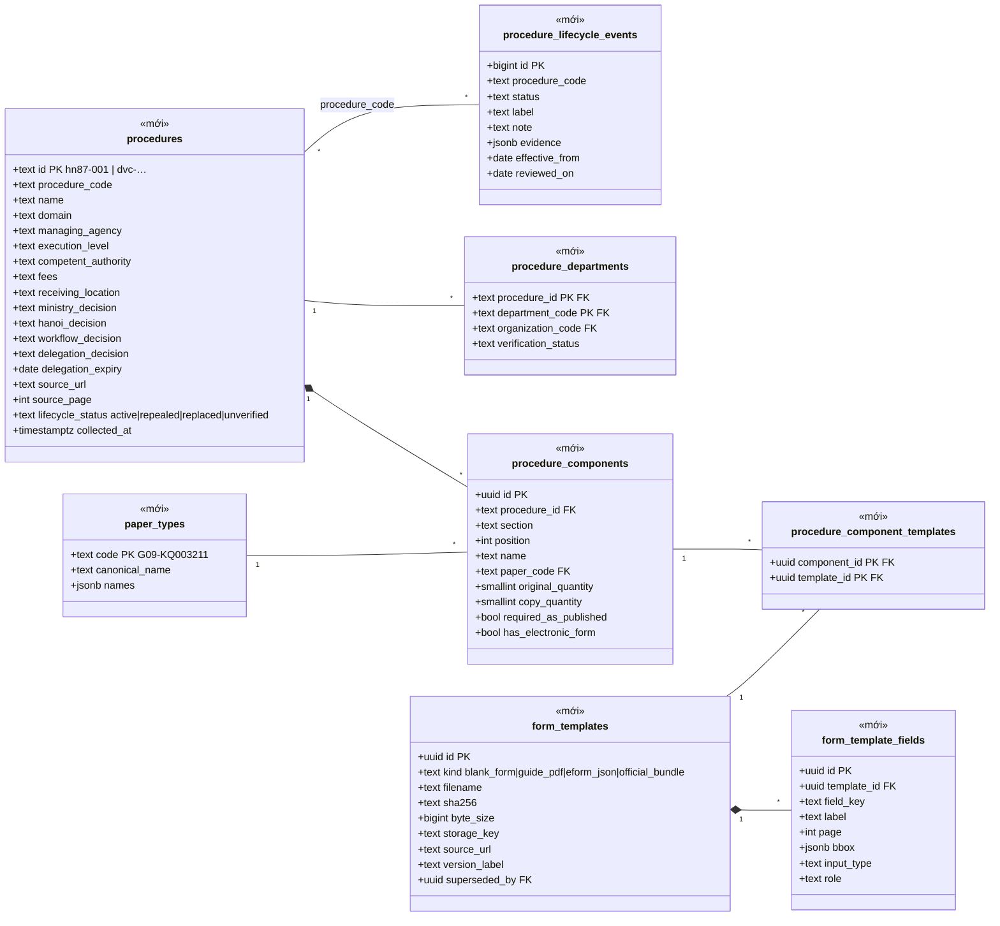

| Điểm thiết kế | Lý do |
|---|---|
| `procedures.id` là mã nguồn (`hn87-001`, `dvc-…`), `procedure_code` không duy nhất | Một mã DVC có thể xuất hiện ở cả danh sách Hà Nội và Cổng DVC Quốc gia |
| `lifecycle_status` + `procedure_lifecycle_events` | 32 thủ tục đã có quyết định thay thế/bãi bỏ; giữ lịch sử, không dùng mẫu cũ làm mẫu hiện hành |
| `required_as_published` | Một thành phần nguồn có thể là điều kiện hoặc lời hướng dẫn, không nhất thiết là giấy phải nộp |
| `form_templates.sha256` | 1.085 tệp chỉ có 768 nội dung khác nhau; tệp lưu một lần, nhiều liên kết |
| `form_template_fields.bbox` | Từ `data/form-test-data/schemas.json`, dùng cho trích xuất theo toạ độ và kiểm thử |

---

## 6. Nhóm D · Tiếp nhận & số hóa

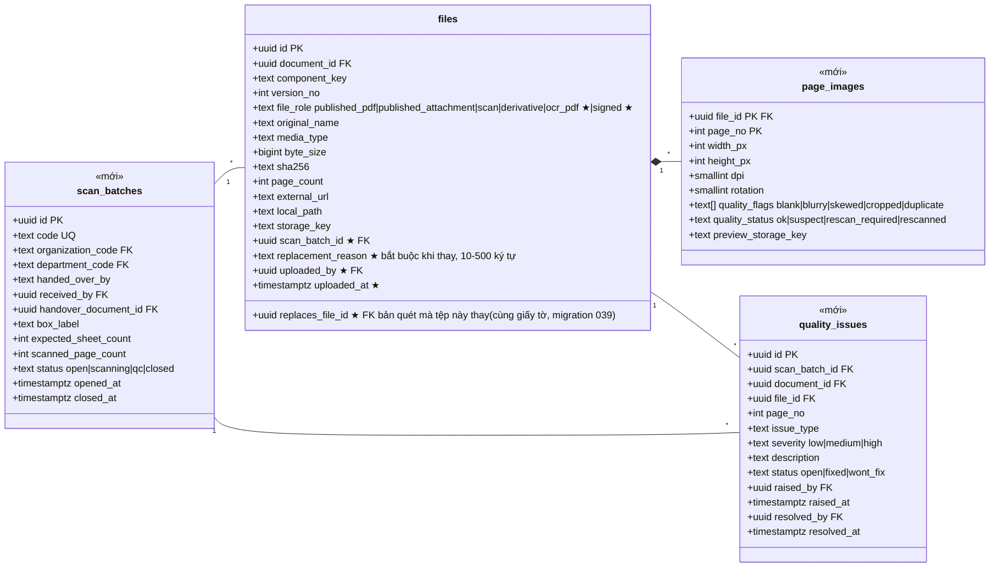

- **Chống trùng:** `CREATE UNIQUE INDEX files_scan_sha256_uq ON files(sha256) WHERE file_role = 'scan'`.
- **Ba lớp tách rõ:** lô quét (`scan_batches`) → tệp quét (`files`) → văn bản (`documents`, tách bằng `document_segments`) → hồ sơ (`dossiers`).
- Biên bản giao nhận là một `documents` (`handover_document_id`), không phải tệp rời.

---

## 7. Nhóm E · Văn bản & tệp

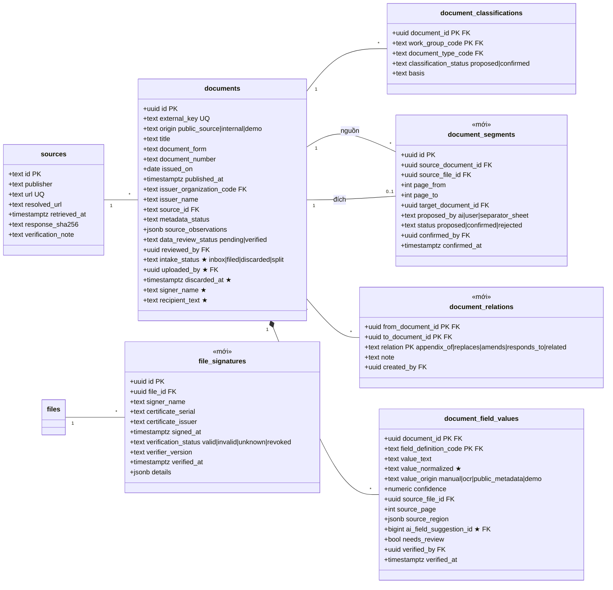

- **Tách văn bản:** PDF 12 trang tiếp nhận thành một văn bản `intake_status = inbox`. Khi xác nhận tách, tạo các văn bản con (đơn 1–2, biên bản 3–5, quyết định 6–8, phụ lục 9–12), mỗi văn bản một dòng `document_segments`; văn bản nguồn chuyển `split`. Phụ lục nối với quyết định bằng `document_relations(appendix_of)`.
- `value_normalized`: ngày ISO, số dạng `80.5`; `value_text` giữ nguyên chuỗi gốc (giữ số 0 đầu trong số ký hiệu).
- Kiểm tra chữ ký chỉ ghi kết quả kỹ thuật, không kết luận hiệu lực pháp lý.

---

## 8. Nhóm F · Xử lý AI

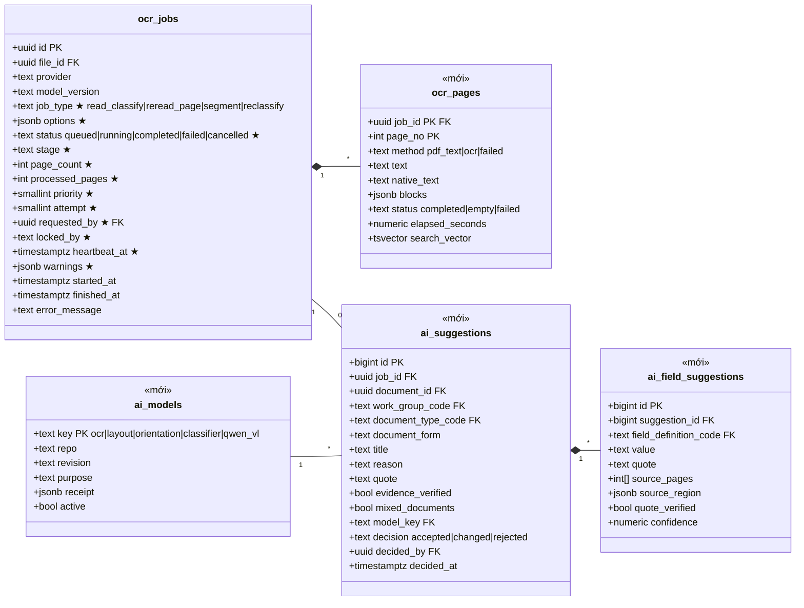

**Giao kèo giữa API .NET và worker Python** (qua DB):

```sql
-- Worker lấy việc
UPDATE hoso.ocr_jobs SET status='running', locked_by=$1, started_at=now(), heartbeat_at=now(), attempt=attempt+1
WHERE id = (SELECT id FROM hoso.ocr_jobs WHERE status='queued'
            ORDER BY priority, created_at FOR UPDATE SKIP LOCKED LIMIT 1)
RETURNING *;
-- Sau mỗi trang: INSERT ocr_pages; UPDATE processed_pages, heartbeat_at; NOTIFY job_progress, '<job_id>:<page>'
-- Kết thúc: INSERT ai_suggestions + ai_field_suggestions; status='completed'; NOTIFY job_progress, '<job_id>:done'
```

Job `running` có `heartbeat_at` cũ hơn 5 phút được trả về `queued` (tối đa 3 lần, sau đó `failed`). Trang đã đọc giữ nguyên, lần sau chỉ đọc trang còn thiếu.

`ai_field_suggestions.source_region` (và `document_field_values.source_region` khi sao sang) là vùng chứa trích dẫn trên trang,
toạ độ theo **tỉ lệ** kích thước trang (0..1), gốc ở góc trên bên trái, trang đánh số từ 1:
`{"page": 2, "x": 0.12, "y": 0.30, "width": 0.40, "height": 0.03}`. Thêm `"approximate": true` khi engine chỉ ước theo vị trí dòng
(trang lấy chữ từ lớp chữ PDF, chưa có khung chữ). `NULL` khi engine không biết vùng. `confidence` từ 0 đến 1, `NULL` khi engine không ước được.
Từ 18/11/2026 (AI-21) AI thật cũng ghi `source_region`: khối bố cục OCR hoặc ô bảng (đa số `approximate`), khung chữ PDFium cho trang có lớp chữ. `confidence` chỉ AI giả ghi; AI thật để `NULL` vì chưa có nguồn đáng tin.

`ai_suggestions` không bao giờ ghi đè dữ liệu đã đối chiếu: khi người dùng chấp nhận, API sao giá trị sang `document_field_values` (`value_origin = 'ocr'`, `needs_review = true`, `ai_field_suggestion_id`), người dùng xác nhận thì `needs_review = false`. Từ hai bảng này đo được tỉ lệ AI đúng theo từng loại giấy tờ và trường.

---

## 9. Nhóm G · Hồ sơ & quy trình

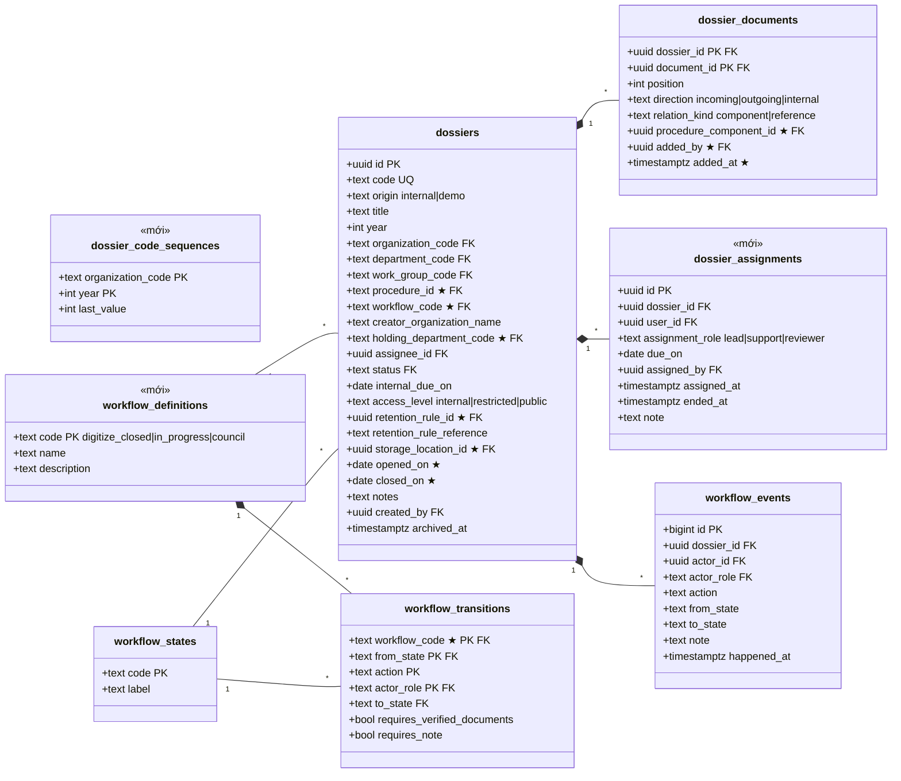

- **Ba quy trình** (luồng A, B, C) cấu hình bằng `workflow_definitions`; 13 luật hiện có gán `workflow_code = 'in_progress'`. Luồng A thay `department_review` bằng bước kiểm tra chất lượng do người được giao trong kế hoạch số hóa thực hiện.
- `dossiers.assignee_id` giữ lại làm người chủ trì hiện tại (cập nhật cùng transaction với `dossier_assignments`) để không phá hàm `scope_matches`.
- **Mã hồ sơ** sinh bằng `UPDATE dossier_code_sequences SET last_value = last_value + 1 … RETURNING`, dạng `UBND-2026-000123`.
- **Đủ thành phần:** view `v_dossier_completeness` kết hợp `document_types.required_in_dossier` (hồ sơ công việc) hoặc `procedure_components.required_as_published` (hồ sơ thủ tục). Hàm `transition_dossier` gọi view này thay cho kiểm tra chung.

---

## 10. Nhóm H · Kho bản giấy (mới)

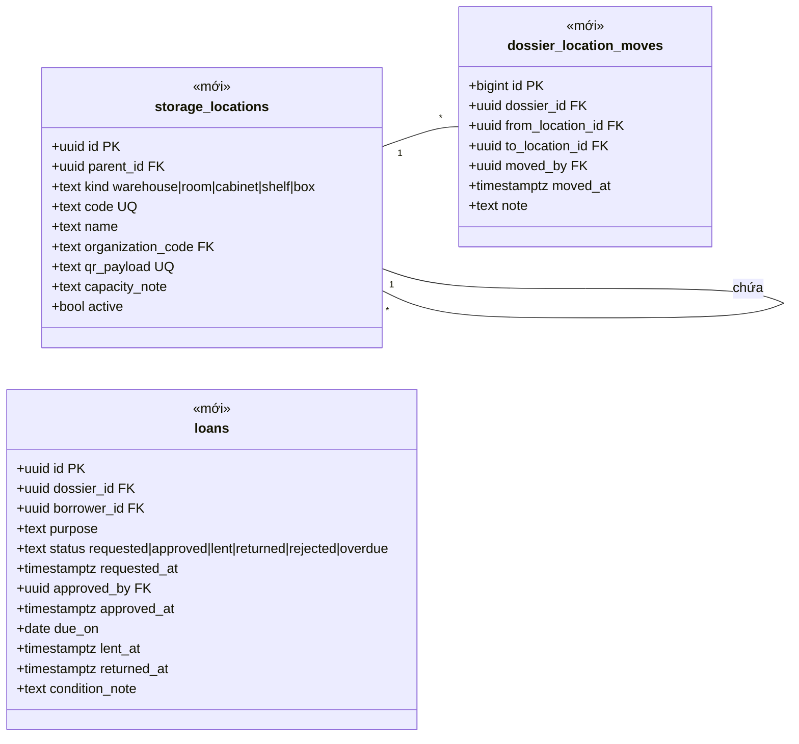

`dossiers.storage_location_id` trỏ tới hộp đang chứa hồ sơ; `loans.dossier_id` và `dossier_location_moves.dossier_id` trỏ tới `dossiers` (nhóm G).

- Cây vị trí dùng `parent_id`; truy vấn đường dẫn đầy đủ bằng CTE đệ quy, cache ở API.
- Mỗi lần đổi `dossiers.storage_location_id` ghi một dòng `dossier_location_moves` (trigger).
- Ràng buộc: một hồ sơ chỉ có một khoản mượn ở trạng thái `approved|lent` (partial unique index).

---

## 11. Nhóm I · Nộp lưu, xuất dữ liệu, hủy (mới)

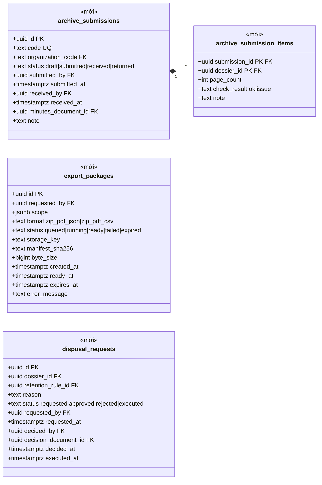

- Nhận nộp lưu một đợt: trong một transaction, gọi `transition_dossier(…, 'archive', …)` cho từng hồ sơ; một hồ sơ lỗi thì cả đợt trả về `submitted` kèm danh sách lỗi.
- Gói xuất gồm PDF, `metadata.json`, `danh-muc.csv`, `manifest.sha256`; mỗi lần xuất ghi `access_events(action='export')`.
- Hủy chỉ thực hiện khi `status = approved` và có `decision_document_id`; hệ thống không tự hủy.

---

## 12. Nhóm J · Hệ thống

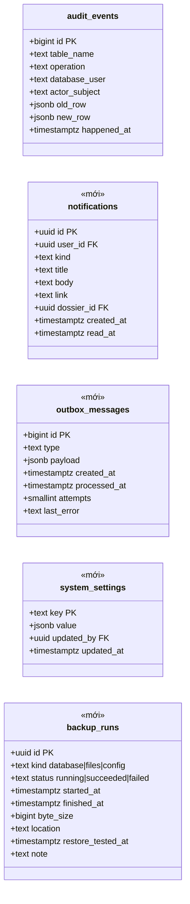

- Trigger `audit_change` mở rộng cho `dossier_documents`, `dossier_assignments`, `document_classifications`, `storage_locations`, `loans`, `user_roles`, `delegations`.
- `audit_events` phân vùng theo tháng khi vượt khoảng 10 triệu dòng.

---

## 13. View và hàm

| Tên | Loại | Mục đích |
|---|---|---|
| `v_public_documents`, `v_dossier_summary`, `v_catalog_composition` | View (đã có) | Giữ nguyên |
| `v_dossier_completeness` | View mới | Mỗi hồ sơ: loại giấy tờ/thành phần bắt buộc, số đã có, số đã đối chiếu, còn thiếu |
| `v_my_queue` | Hàm mới `my_queue(p_user, p_user_role)` | Hàng việc theo phân công: hồ sơ được giao, chờ kiểm tra, chờ ý kiến, chờ nộp lưu, PDF chờ xếp |
| `v_ai_accuracy` | View mới | Theo loại giấy tờ, trường: tỉ lệ gợi ý được chấp nhận nguyên, bị sửa, bị bỏ |
| `scope_matches` | Hàm (sửa) | Thêm ủy quyền, `restricted`, `is_deputy` |
| `transition_dossier` | Hàm (sửa) | Thêm `workflow_code`, kiểm tra qua `v_dossier_completeness`, kiểm tra `row_version`, ghi `outbox_messages` |
| `next_dossier_code(org, year)` | Hàm mới | Sinh mã hồ sơ an toàn khi chạy đồng thời |
| `search_documents(q, filters)` | Hàm mới | Kết hợp `documents_search_idx`, `ocr_pages.search_vector` (unaccent), `pg_trgm` cho số ký hiệu |

## 14. Chỉ mục chính

| Bảng | Chỉ mục | Phục vụ |
|---|---|---|
| `files` | `UNIQUE (sha256) WHERE file_role='scan'` | Chống nạp trùng |
| `documents` | `(intake_status, uploaded_by)`, GIN `to_tsvector('simple', unaccent(title \|\| number))` | Hộp tiếp nhận, tìm kiếm |
| `ocr_jobs` | `(priority, created_at) WHERE status='queued'`; `(status, heartbeat_at) WHERE status='running'` | Lấy việc, thu hồi job treo |
| `ocr_pages` | GIN `search_vector` | Tìm toàn văn |
| `document_field_values` | `(document_id) WHERE needs_review` | Đếm trường chờ đối chiếu |
| `dossiers` | Đã có `dossiers_queue_idx`, `dossiers_assignee_idx`; thêm GIN trigram `title` | Danh sách, tìm hồ sơ |
| `dossier_assignments` | `(user_id) WHERE ended_at IS NULL` | Việc của tôi |
| `notifications` | `(user_id, created_at DESC) WHERE read_at IS NULL` | Chuông thông báo |
| `outbox_messages` | `(id) WHERE processed_at IS NULL` | Dispatcher |
| `loans` | `UNIQUE (dossier_id) WHERE status IN ('approved','lent')` | Một khoản mượn mỗi lúc |

## 15. Thứ tự migration

| File | Nội dung |
|---|---|
| `001`–`007` | Giữ nguyên (baseline), DbUp ghi nhận đã chạy |
| `008_extensions_conventions.sql` | `unaccent`, `pg_trgm`; cột `row_version` (xmin), mở rộng CHECK `file_role`, `ocr_jobs.status` |
| `009_catalog_ext.sql` | `organization_names`, cột mới của danh mục, `retention_rules` |
| `010_identity_ext.sql` | Cột mới `users`, `user_roles.is_deputy`, `delegations`, `document_access_grants`, `access_events` (phân vùng), quyền mới |
| `011_procedures.sql` | Nhóm C |
| `012_intake.sql` | `scan_batches`, cột mới `files`/`documents`, `page_images`, `quality_issues`, chỉ mục chống trùng |
| `013_processing.sql` | `ai_models`, cột mới `ocr_jobs`, `ocr_pages`, `ai_suggestions`, `ai_field_suggestions` |
| `014_documents_ext.sql` | `document_segments`, `document_relations`, `file_signatures`, cột mới `document_field_values` |
| `015_dossiers_ext.sql` | `workflow_definitions`, cột `workflow_code`, `dossier_assignments`, `dossier_code_sequences`, cột mới `dossiers`, `dossier_documents` |
| `016_physical_storage.sql` | Nhóm H |
| `017_archive_export.sql` | Nhóm I |
| `018_system.sql` | `notifications`, `outbox_messages`, `system_settings`, `backup_runs`, trigger audit mở rộng |
| `019_views_functions.sql` | View và hàm ở mục 13; thay `scope_matches`, `transition_dossier` |
| `020_db_roles.sql` | Role `hoso_migrator`, `hoso_api`, `hoso_ai_worker`, `hoso_readonly` với GRANT tối thiểu |

Mỗi migration kèm kiểm thử trong `database/scripts/test_database.py` (giữ cách chạy trong transaction rồi ROLLBACK) và kiểm thử tích hợp .NET bằng Testcontainers.
