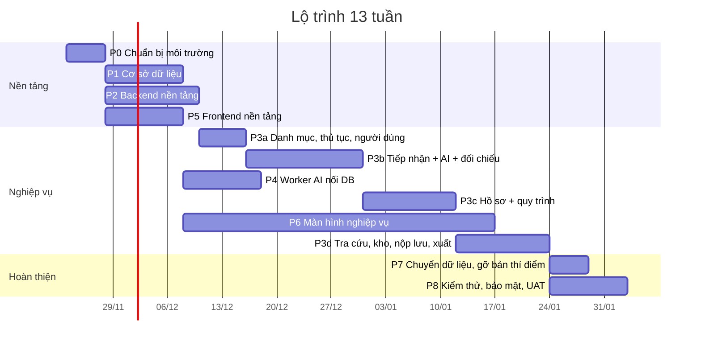

# 04 · Kế hoạch triển khai và danh sách task

Mỗi task nhỏ, làm trong **0,5–2 ngày công**, có đầu ra kiểm tra được. Mã task dùng để đặt tên nhánh và commit, ví dụ `feat/BE-31-upload-file`.

Chi tiết từng bước, tệp cần sửa và trạng thái khung: [tasks/backend.md](tasks/backend.md), [tasks/frontend.md](tasks/frontend.md). Task bảo mật `SEC-*`: [05-bao-mat.md](05-bao-mat.md). Task log `LOG-*`: [06-log-va-giam-sat.md](06-log-va-giam-sat.md).

Nhóm thực hiện: **DB** cơ sở dữ liệu · **BE** backend .NET · **AI** worker Python · **FE** frontend · **OPS** hạ tầng · **QA** kiểm thử.

## 0. Định nghĩa hoàn thành (áp dụng cho mọi task)

- [ ] Code qua review, build không cảnh báo, lint sạch.
- [ ] Có test: unit cho quy tắc nghiệp vụ; integration cho endpoint (gồm ít nhất một ca **ngoài phạm vi trả 403/404**).
- [ ] Endpoint mới có trong OpenAPI, mô tả tiếng Việt, ví dụ request/response.
- [ ] Migration chạy được trên CSDL mới **và** CSDL đã có 001–007; chạy lại không lỗi.
- [ ] Màn hình mới dùng được bằng bàn phím, hiển thị đúng ở 1280px và 768px, có trạng thái đang tải, rỗng, lỗi.
- [ ] Thông báo lỗi nói rõ sai gì và cách sửa, bằng tiếng Việt.
- [ ] Không log nội dung giấy tờ, số định danh cá nhân.

## Trạng thái thực tế (đối chiếu với mã, 19/11/2026)

Các bảng bên dưới là **kế hoạch**, không có cột trạng thái. Trạng thái chi tiết của BE, FE, AI từ AI-12 trở đi nằm ở `tasks/backend.md`, `tasks/frontend.md`, `tasks/ai.md`. Phần còn lại (đã đối chiếu với mã và tài liệu, không phải do nghiệm thu):

| Nhóm | Đã làm (có bằng chứng) | Làm dở | Chưa làm |
|---|---|---|---|
| **P0** môi trường | P0-01, P0-02 (git, `.gitignore`), P0-03 một phần (`docker-compose.dev.yml` có, **Docker không chạy trên máy dev nên chưa thử**), P0-05 (`CONTRIBUTING.md`, 19/11/2026) | P0-04 (compose trỏ `infra/keycloak` nhưng thư mục chưa có); P0-06 (`.github/workflows/ci.yml` đã viết và tập dượt cục bộ, **chưa chạy trên GitHub Actions**) | |
| **P1** CSDL | DB-01…DB-19: migration 000–042 chạy trên CSDL mới và CSDL cũ, có test; DB-19 đã đo 20.000 hồ sơ (mọi ca 2–8 ms) | | |
| **P4** AI | AI-02…AI-08, AI-10 (19/11/2026: view `v_ai_accuracy` + `scripts/report-ai-accuracy.py`), AI-12…AI-15, AI-20 (một phần), AI-21, AI-22, AI-23 | AI-01 (còn `TODO(AI-01)`), AI-09 (có script dịch vụ, chưa cài thật), AI-12 và AI-20 (chưa đo giấy tờ thật) | AI-11 (phần lớn thay bằng Ollama), AI-16, AI-17, AI-18 (không còn cần với hồ sơ `ollama`), AI-19 (bản dev có `supervise.sh`; dịch vụ launchd/systemd chưa cài thật) |
| **P7** chuyển đổi | | | MG-01…MG-04 (`scan-inbox.html` vẫn dùng scan-bridge; **hoãn có chủ ý**, đã dò 19/11/2026: dữ liệu thí điểm ở `data/sam3/runtime/inbox.json` chỉ là 11 mẫu mô phỏng nên MG-01 gần như không có gì để nhập, MG-02 không có tệp xuất nào, MG-04 phải viết lại liên kết sang các trang cũ, MG-03 gỡ mã nên cần người dùng đồng ý) |
| **P8** kiểm thử, vận hành | QA-01 (19/11/2026: ma trận `docs/ma-tran-quyen.md` sinh từ mã + `PermissionEnforcementTests` gọi thật từng endpoint bằng từng vai trò: không quyền thì 403, có quyền thì không bị chặn ở endpoint đọc, chưa đăng nhập thì 401; phạm vi dữ liệu kiểm ở `ScopeTests`, `AssignmentScopeTests`, `ScopePrefilterTests`), QA-05 (một phần, xem bên cạnh), QA-07, OPS-04 (diễn tập khôi phục có biên bản), OPS-06 (`08-so-tay-van-hanh.md`, **mới phạm vi máy dev**), OPS-07, OPS-08 | QA-02 (có E2E tích hợp 34 ca + giả lập 7 ca; giả lập có trong CI, tích hợp cần stack thật nên chạy tay), QA-05 (axe quét mọi màn trong menu của 6 vai trò; chưa quét mọi màn con), OPS-03 (chưa sao lưu WAL), OPS-05 (mới có profile Loki trong compose) | QA-03, QA-04, QA-06, OPS-01, OPS-02 |
| **P9** bảo mật, log | SEC-02, SEC-04 (19/11/2026: luật ESLint `eslint-rules/hoso.mjs`), SEC-05 (ClamAV mới thử với máy chủ `clamd` giả), SEC-07, LOG-03, LOG-05 (19/11/2026: migration 041), LOG-06, LOG-08 | LOG-01 (profile Loki trong compose, chưa chạy) | SEC-01, SEC-03, SEC-06, SEC-08, LOG-02, LOG-04, LOG-07 |

Chưa kiểm chứng với hạ tầng thật: Keycloak, MinIO/S3 thật, ClamAV thật, runtime .NET 10 thật (máy dev chỉ có runtime 11), tải nhiều người dùng. Chi tiết ở đầu `tasks/backend.md`.

## 1. Mốc tiến độ

Ước lượng cho đội 2 BE, 1–2 FE, 1 AI/DB bán thời gian. Khớp khung 10–14 tuần trong đề xuất.

| Mốc | Tuần | Kết quả demo được |
|---|---|---|
| **M1** Nền tảng | 1–3 | Đăng nhập Keycloak, `/me` trả phân công, CSDL đủ 20 migration, frontend có khung và menu theo vai trò |
| **M2** Tiếp nhận | 4–6 | Kéo thả PDF → hàng đợi → AI đọc → màn đối chiếu → lưu trường đã xác nhận |
| **M3** Hồ sơ | 7–9 | Xếp giấy tờ vào hồ sơ, danh sách kiểm tra đủ, trình → kiểm tra → ý kiến lãnh đạo → nộp lưu, thông báo realtime |
| **M4** Khai thác | 10–11 | Tra cứu toàn văn, kho bản giấy và mượn trả, nộp lưu theo đợt, xuất gói bàn giao |
| **M5** Nghiệm thu | 12–13 | Gỡ bản thí điểm, kiểm thử trái quyền, tải, sao lưu và khôi phục, UAT với kịch bản thật |

---

## P0 · Chuẩn bị môi trường

| ID | Task | Đầu ra / tiêu chí chấp nhận | Phụ thuộc | Ngày | Nhóm |
|---|---|---|---|---|---|
| P0-01 | Cài .NET 10 SDK, Node 22 LTS, Docker, kiểm tra `psql` 16 | `dotnet --list-sdks` có 10.x; ghi phiên bản vào `README.md` gốc | — | 0,5 | OPS |
| P0-02 | Khởi tạo git, `.gitignore` cho .NET/Node/Python, `.editorconfig`, `.gitattributes` (LF) | Commit đầu không có `bin/`, `node_modules/`, `data/sam3/runtime`, tệp mô hình | — | 0,5 | OPS |
| P0-03 | `docker-compose.dev.yml`: postgres:16, keycloak, minio, mailpit | `docker compose up` chạy cả 4; volume có tên; README mô tả cổng | P0-01 | 1 | OPS |
| P0-04 | Realm Keycloak `hoso` xuất JSON: client `hoso-web` (PKCE), `hoso-api` (audience), 6 tài khoản demo khớp `004_seed_demo_optional.sql` | Import tự động khi compose khởi động; đăng nhập được bằng `demo_head_kt` | P0-03 | 1 | OPS |
| P0-05 | Quy ước nhánh, commit, mẫu PR, CODEOWNERS | `CONTRIBUTING.md` | P0-02 | 0,5 | OPS |
| P0-06 | CI: build + test backend, lint + test + build frontend, chạy migration trên Postgres dịch vụ | Pipeline xanh trên nhánh chính; chặn merge khi đỏ | P0-02, BE-01, FE-01 | 1 | OPS |

## P1 · Cơ sở dữ liệu

| ID | Task | Đầu ra / tiêu chí chấp nhận | Phụ thuộc | Ngày | Nhóm |
|---|---|---|---|---|---|
| DB-01 | Chuyển `database/001…007` vào `backend/database/migrations` giữ nguyên nội dung; bỏ lệnh `\ir`, `\set` để DbUp chạy được | DbUp chạy 001–007 trên DB trống cho kết quả giống `install.sql` (so `pg_dump --schema-only`) | P0-03 | 1 | DB |
| DB-02 | `008_extensions_conventions.sql` | Có `unaccent`, `pg_trgm`; CHECK mới của `files.file_role`, `ocr_jobs.status` | DB-01 | 0,5 | DB |
| DB-03 | `009_catalog_ext.sql` | Bảng/cột nhóm A; seed `organization_names` cho 2 tổ chức | DB-02 | 0,5 | DB |
| DB-04 | `010_identity_ext.sql` | Nhóm B; `access_events` phân vùng theo tháng + hàm tạo phân vùng tháng sau; 17 quyền mới gán cho vai trò | DB-02 | 1 | DB |
| DB-05 | `011_procedures.sql` | 8 bảng nhóm C có khóa, chỉ mục tìm kiếm tên thủ tục | DB-02 | 1 | DB |
| DB-06 | Script nhập thủ tục từ `data/official-forms` (`procedures.json`, `components.json`, `papers.json`, `files.json`, `lifecycle.json`) và `form-test-data/schemas.json` | Chạy lại không trùng; số lượng khớp: 425 + DVC, 2.738 thành phần, 3.964 loại giấy; báo cáo dòng bị bỏ | DB-05 | 2 | DB |
| DB-07 | `012_intake.sql` | Nhóm D + cột mới `documents`; chỉ mục chống trùng sha256 | DB-02 | 1 | DB |
| DB-08 | `013_processing.sql` | Nhóm F; seed `ai_models` từ `document_ai/config.py` (repo, revision) | DB-07 | 1 | DB |
| DB-09 | `014_documents_ext.sql` | `document_segments`, `document_relations`, `file_signatures`, cột mới `document_field_values` | DB-07 | 1 | DB |
| DB-10 | `015_dossiers_ext.sql` | `workflow_definitions` (3 luồng) + chuyển 13 luật vào `in_progress`; luật cho `digitize_closed` và `council`; `dossier_assignments` + dữ liệu từ `assignee_id`; `dossier_code_sequences` | DB-02 | 1,5 | DB |
| DB-11 | `016_physical_storage.sql` | Nhóm H; trigger ghi `dossier_location_moves`; chuyển `physical_location` text cũ thành ghi chú | DB-10 | 1 | DB |
| DB-12 | `017_archive_export.sql` | Nhóm I | DB-10 | 0,5 | DB |
| DB-13 | `018_system.sql` | Nhóm J; mở rộng trigger audit cho 7 bảng | DB-04 | 0,5 | DB |
| DB-14 | `019_views_functions.sql`: `v_dossier_completeness`, `my_queue`, `v_ai_accuracy`, `next_dossier_code`, `search_documents` | Mỗi view/hàm có ca kiểm thử với dữ liệu demo | DB-03…DB-13 | 2 | DB |
| DB-15 | Viết lại `scope_matches` (ủy quyền, restricted, cấp phó) và `transition_dossier` (workflow_code, completeness, outbox) | Toàn bộ ca cũ trong `006_verify.sql` vẫn qua; thêm ca ủy quyền hết hạn bị từ chối | DB-14 | 2 | DB |
| DB-16 | `020_db_roles.sql`: role `hoso_migrator`, `hoso_api`, `hoso_ai_worker`, `hoso_readonly` | `hoso_api` không UPDATE/DELETE được bảng nhật ký; worker chỉ ghi bảng nhóm F | DB-15 | 1 | DB |
| DB-17 | Cập nhật `test_database.py` và `006_verify.sql` cho migration mới | `python3 database/scripts/test_database.py` xanh | DB-16 | 1 | DB |
| DB-18 | Seed dev: tài khoản demo có `external_auth_subject` khớp Keycloak, kho bản giấy mẫu, 2 lô quét mẫu | Đăng nhập demo thấy đúng hồ sơ theo phạm vi | DB-16, P0-04 | 1 | DB |
| DB-19 | Đo hiệu năng với dữ liệu giả 300.000 trang, 20.000 hồ sơ | Danh sách hồ sơ theo phạm vi < 200 ms, tìm toàn văn < 500 ms (p95); ghi `EXPLAIN` vào tài liệu | DB-14 | 1,5 | DB |

## P2 · Backend nền tảng

| ID | Task | Đầu ra / tiêu chí chấp nhận | Phụ thuộc | Ngày | Nhóm |
|---|---|---|---|---|---|
| BE-01 | Tạo solution: 4 project src + 3 project test; `Directory.Build.props` (net10.0, nullable, warnings as errors), `Directory.Packages.props` | `dotnet build` và `dotnet test` chạy được | P0-01 | 0,5 | BE |
| BE-02 | Cấu hình: Options có validate khi khởi động (DB, Storage, Oidc, Ai, Limits); `appsettings.Development.json` | Thiếu cấu hình bắt buộc thì dừng với thông báo rõ | BE-01 | 0,5 | BE |
| BE-03 | Serilog JSON + CorrelationId middleware + OpenTelemetry (trace HTTP, EF, Npgsql) | Mọi log của một request có cùng `correlation_id`; header `X-Correlation-Id` | BE-01 | 1 | BE |
| BE-04 | DbUp runner: lệnh `dotnet HoSoSo.Api.dll migrate`; tùy chọn tự chạy khi dev | Ghi lịch sử vào bảng `schemaversions`; không chạy migration khi khởi động ở production | BE-01, DB-01 | 1 | BE |
| BE-05 | `HoSoDbContext` + mapping nhóm A, B (snake_case, Npgsql, enum converter) | Truy vấn đọc danh mục qua EF khớp dữ liệu SQL | BE-04, DB-04 | 1,5 | BE |
| BE-06 | Mapping nhóm C, D, E, F | Kiểm thử đọc/ghi từng entity trên Testcontainers | BE-05 | 2 | BE |
| BE-07 | Mapping nhóm G, H, I, J + `row_version` (xmin) cho bảng sửa đồng thời | Xung đột phiên bản trả `DbUpdateConcurrencyException` | BE-06 | 1,5 | BE |
| BE-08 | Interceptor đặt `SET LOCAL hoso.actor_subject` mỗi transaction | `audit_events.actor_subject` có giá trị khi sửa qua API | BE-07 | 0,5 | BE |
| BE-09 | Xử lý lỗi: ProblemDetails, bảng mã lỗi (mục 6 tài liệu 02), chuyển exception PL/pgSQL thành 403/409/422 | Ca `transition_dossier` lỗi trả đúng mã và thông điệp tiếng Việt | BE-01 | 1 | BE |
| BE-10 | Validation bằng FluentValidation, filter chung cho endpoint | Sai dữ liệu trả 400 kèm lỗi theo từng trường | BE-09 | 0,5 | BE |
| BE-11 | OpenAPI + Scalar ở `/docs` (chỉ dev), versioning `/api/v1`, xuất `openapi.json` khi build | FE sinh client được từ tệp xuất | BE-01 | 0,5 | BE |
| BE-12 | Xác thực JWT từ Keycloak (JWKS, audience, issuer), map `sub` → `users.external_auth_subject`, cập nhật `last_login_at` | Token sai hoặc hết hạn trả 401; người dùng `active=false` trả 403 | BE-05, P0-04 | 1 | BE |
| BE-13 | `ICurrentUser` + `AssignmentResolver`: đọc header `X-Assignment-Id`, kiểm tra phân công/ủy quyền còn hiệu lực, mặc định phân công đầu tiên | Gửi id phân công của người khác trả 403 | BE-12, DB-15 | 1,5 | BE |
| BE-14 | Policy theo permission (`[RequirePermission("dossier.assign")]`) | Unit test ma trận vai trò × quyền khớp `role_permissions` | BE-13 | 1 | BE |
| BE-15 | `IScopeFilter` áp phạm vi cho truy vấn hồ sơ, giấy tờ, tệp (tương đương `scope_matches`) | Test cho 6 vai trò × 4 tình huống; khớp kết quả hàm SQL | BE-14 | 2 | BE |
| BE-16 | Middleware ghi `access_events` cho xem, tải, in, xuất, tìm kiếm (ghi nền, không chặn request) | Tải tệp ghi đúng một dòng | BE-15 | 1 | BE |
| BE-17 | Hạ tầng test tích hợp: Testcontainers Postgres, chạy migration một lần mỗi phiên, `WebApplicationFactory`, auth giả theo người dùng demo, Respawn dọn dữ liệu | Viết test endpoint mới không quá 10 dòng chuẩn bị | BE-04, BE-12 | 1,5 | BE |
| BE-18 | Health checks `/health/live`, `/health/ready` (DB, kho tệp, độ trễ hàng đợi AI) | Dừng Postgres thì `/ready` trả 503 | BE-02 | 0,5 | BE |
| BE-19 | Bảo mật HTTP: rate limit theo người dùng, giới hạn kích thước request, CORS chỉ origin frontend, security headers | Tải tệp vượt giới hạn trả 413 | BE-02 | 0,5 | BE |
| BE-20 | Outbox: ghi `outbox_messages` cùng transaction; `OutboxDispatcher` (HostedService) xử lý, thử lại có giãn cách | Dừng API giữa chừng, khởi động lại vẫn gửi đủ một lần | BE-07 | 1,5 | BE |
| BE-21 | `IFileStorage`: `LocalFileStorage` (đường dẫn `ab/cd/<sha256>`), `S3FileStorage` (MinIO); ghi qua tệp tạm rồi đổi tên | Ghi trùng nội dung không tạo tệp mới; đọc theo Range | BE-02 | 1,5 | BE |
| BE-22 | `PgNotificationListener`: LISTEN `job_progress`, `job_queued`, tự kết nối lại | Mất kết nối DB 30 giây vẫn nhận lại sự kiện | BE-05 | 1 | BE |
| BE-23 | Luồng SSE `GET /api/v1/events`: tiến độ job, thông báo, hồ sơ thay đổi; theo người dùng; `Last-Event-ID` | Client chỉ nhận sự kiện của mình hoặc trong phạm vi | BE-22, BE-13 | 1 | BE |

## P3 · Backend nghiệp vụ

### P3a · Danh mục, thủ tục, người dùng

| ID | Task | Đầu ra / tiêu chí chấp nhận | Phụ thuộc | Ngày | Nhóm |
|---|---|---|---|---|---|
| BE-30 | `GET /me`: hồ sơ, phân công, ủy quyền nhận được, quyền hiệu lực | FE dựng menu chỉ từ endpoint này | BE-13 | 0,5 | BE |
| BE-31 | API danh mục đọc: tổ chức, đầu mối, nhóm hồ sơ (lọc theo tổ chức, đầu mối), loại giấy tờ + trường; ETag, cache bộ nhớ | 38 nhóm, 427 loại, 2.624 trường; request lặp trả 304 | BE-05 | 1 | BE |
| BE-32 | API sửa danh mục (`catalog.manage`): thêm/sửa nhóm, loại, trường, đánh dấu xác nhận, ngừng dùng | Không xóa loại đã có giấy tờ; chỉ `active=false` | BE-31 | 1,5 | BE |
| BE-33 | API thủ tục: tìm theo tên/mã/lĩnh vực/trạng thái, chi tiết kèm thành phần và mẫu, tải mẫu | Tìm “khai sinh” không dấu ra kết quả; thủ tục bãi bỏ có nhãn | BE-06, DB-06 | 1,5 | BE |
| BE-34 | API quản trị người dùng, phân công (có thời hạn, căn cứ), ủy quyền, thu hồi | Phân công trái CHECK của DB trả 422 rõ ràng | BE-14 | 2 | BE |
| BE-35 | API `retention_rules` (đề xuất, xác nhận có căn cứ) | Chỉ quyền `catalog.manage` xác nhận | BE-32 | 0,5 | BE |

### P3b · Tiếp nhận, AI, đối chiếu

| ID | Task | Đầu ra / tiêu chí chấp nhận | Phụ thuộc | Ngày | Nhóm |
|---|---|---|---|---|---|
| BE-40 | API lô quét: tạo, xem, đóng; đếm trang dự kiến/đã quét | Đóng lô khi còn lỗi ảnh mở thì cảnh báo, không chặn | BE-07 | 1 | BE |
| BE-41 | `POST /intake/files`: stream multipart, tính SHA-256 khi đọc, kiểm tra `%PDF-`, đếm trang (PdfPig), chống trùng, tạo `documents`+`files`+`ocr_jobs` trong một transaction | Tệp 100 MB không nạp hết vào RAM; trùng trả 409 kèm id cũ; tệp không phải PDF trả 415 | BE-21, DB-07 | 2 | BE |
| BE-42 | Hộp tiếp nhận: danh sách theo trạng thái, người tải, lô; bỏ và hoàn tác | Hoàn tác trong 30 ngày; giấy tờ đã xếp không bỏ được | BE-41 | 1 | BE |
| BE-43 | Xem tệp: `GET /files/{id}/content` có Range, `GET /files/{id}/pages/{n}/preview` (PDFium → WebP, cache vào kho tệp) | pdf.js mở được tệp 300 trang không tải toàn bộ; kiểm tra phạm vi trước khi trả | BE-21, BE-15 | 1,5 | BE |
| BE-44 | API job: trạng thái, vị trí trong hàng, hủy, đọc lại một trang | Hủy job đang chạy: worker dừng sau trang hiện tại | BE-22, DB-08 | 1 | BE |
| BE-45 | Đẩy tiến độ qua `JobsHub` từ NOTIFY | Tiến độ từng trang hiện trên FE trong vòng 1 giây | BE-23, BE-44 | 0,5 | BE |
| BE-46 | Thu hồi job treo (HostedService): `heartbeat_at` quá 5 phút → `queued`, quá 3 lần → `failed` | Tắt worker giữa chừng, bật lại thì job chạy tiếp từ trang chưa đọc | BE-44 | 0,5 | BE |
| BE-47 | `GET /documents/{id}/review`: gợi ý AI, trường theo `field_definitions` có giá trị gợi ý, trang/vùng nguồn, cờ cần chú ý (trống, quote không khớp, trường quan trọng) | Trường cần chú ý xếp đầu | BE-06, DB-08 | 1,5 | BE |
| BE-48 | `PUT /documents/{id}/classification`: chấp nhận/đổi gợi ý; đổi nhóm giữ giá trị cũ, đánh dấu cần đối chiếu lại | `ai_suggestions.decision` đúng accepted/changed | BE-47 | 1 | BE |
| BE-49 | `PATCH /documents/{id}/fields`: sửa nhiều trường, kiểm tra theo `value_type`, chuẩn hóa ngày/số vào `value_normalized`, xác nhận | Ngày “20/01/2026” → `2026-01-20`; số “80,5” → `80.5` | BE-47 | 1,5 | BE |
| BE-50 | `POST /documents/{id}/verify`: kiểm tra không còn trường `needs_review`, `metadata_status ≠ needs_review` | Thiếu điều kiện trả 422 kèm danh sách | BE-49 | 0,5 | BE |
| BE-51 | Tách văn bản: nhận đề xuất (AI `mixed_documents` hoặc người dùng), xác nhận → tạo văn bản con, tệp dẫn xuất theo dải trang, chuyển nguồn sang `split` | Dải trang chồng nhau hoặc hở trả 422 | BE-41, DB-09 | 2 | BE |
| BE-52 | Liên kết văn bản (phụ lục, thay thế, trả lời) | Không tạo vòng `appendix_of` | DB-09 | 0,5 | BE |
| BE-53 | Lỗi chất lượng ảnh: tạo, giải quyết, lọc theo lô; tự tạo từ `page_images.quality_flags` | Trang trắng nghi vấn tạo lỗi mức thấp, không tự xóa trang | BE-40 | 1 | BE |
| BE-54 | Spike kiểm tra chữ ký số PDF (BouncyCastle đọc CMS trong `/ByteRange`) | Báo cáo khả thi + mẫu thử trên 3 PDF có ký số từ `database/samples` | BE-43 | 2 | BE |

### P3c · Hồ sơ và quy trình

| ID | Task | Đầu ra / tiêu chí chấp nhận | Phụ thuộc | Ngày | Nhóm |
|---|---|---|---|---|---|
| BE-60 | `GET /dossiers`: lọc trạng thái, nhóm, đầu mối, năm, hạn, người được giao, từ khóa; phân trang keyset; sắp xếp | Chuyên viên chỉ thấy hồ sơ được giao; 20.000 hồ sơ < 200 ms | BE-15 | 1,5 | BE |
| BE-61 | Tạo, sửa hồ sơ: chọn tổ chức → đầu mối → nhóm (kiểm tra khớp `work_groups`), thủ tục tùy chọn, mã sinh bằng `next_dossier_code` | Tạo đồng thời 50 hồ sơ không trùng mã | BE-60, DB-14 | 1,5 | BE |
| BE-62 | Giấy tờ trong hồ sơ: thêm (từ hộp tiếp nhận hoặc giấy tờ có sẵn), gỡ, sắp xếp, đổi chiều đến/đi/nội bộ, gán thành phần thủ tục | Chỉ sửa khi hồ sơ ở `draft`/`returned`; thêm từ hộp tiếp nhận đổi `intake_status=filed` cùng transaction | BE-61 | 1,5 | BE |
| BE-63 | `GET /dossiers/suggestions?documentId=`: hồ sơ cùng nhóm, đang chuẩn bị, trong phạm vi, sắp theo gần đây | Trả tối đa 10 gợi ý | BE-62 | 0,5 | BE |
| BE-64 | `GET /dossiers/{id}/checklist` từ `v_dossier_completeness` | Mỗi dòng: tên thành phần, bắt buộc, đã có, đã đối chiếu, việc cần làm | BE-62, DB-14 | 1 | BE |
| BE-65 | Phân công: giao người chủ trì, người phối hợp, hạn nội bộ; lịch sử | Chỉ `manager` của đơn vị; tạo thông báo cho người được giao | BE-20, BE-61 | 1 | BE |
| BE-66 | `GET /dossiers/{id}/actions`: thao tác được phép theo bước, vai trò, phạm vi; kèm cờ cần ý kiến, lý do bị khóa | FE không phải tự suy luật | BE-15, DB-15 | 1 | BE |
| BE-67 | `POST /dossiers/{id}/transitions`: gọi `transition_dossier`, kiểm tra `row_version`, ghi outbox | Hai người bấm cùng lúc: một thành công, một nhận 409 | BE-66, BE-20 | 1,5 | BE |
| BE-68 | `GET /dossiers/{id}/history`: gộp `workflow_events`, thay đổi phân công, thêm/gỡ giấy tờ (từ audit) | Có tên người, vai trò, thời điểm, ý kiến | BE-67 | 1 | BE |
| BE-69 | Màn “Việc của tôi”: `GET /workspace/summary`, `/workspace/queue` từ `my_queue` | Mỗi vai trò thấy đúng hàng việc trong tài liệu 01 mục 3 | DB-14, BE-13 | 1 | BE |
| BE-70 | Thông báo: tạo từ outbox (được giao, bị trả lại, chờ ý kiến, sắp đến hạn), đánh dấu đã đọc, đẩy qua SSE (`notification.created`) | Thông báo đến đúng người, không trùng | BE-20, BE-23 | 1,5 | BE |
| BE-71 | Nhắc hạn (HostedService chạy hằng ngày): hồ sơ còn 2 ngày đến hạn, quá hạn | Mỗi hồ sơ nhắc tối đa 1 lần/ngày | BE-70 | 0,5 | BE |

### P3d · Tra cứu, kho bản giấy, nộp lưu, xuất dữ liệu

| ID | Task | Đầu ra / tiêu chí chấp nhận | Phụ thuộc | Ngày | Nhóm |
|---|---|---|---|---|---|
| BE-80 | `GET /search`: số ký hiệu (trigram), trích yếu, toàn văn OCR (không dấu), lọc thời gian, cơ quan, loại; đoạn trích và số trang trúng | Kết quả ngoài phạm vi không xuất hiện, kể cả số lượng | DB-14, BE-15 | 2 | BE |
| BE-81 | Kho bản giấy: cây vị trí CRUD, đường dẫn đầy đủ, sinh mã QR (PNG/SVG), in nhãn hàng loạt (PDF A4) | Quét QR mở đúng hộp và danh sách hồ sơ | DB-11 | 1,5 | BE |
| BE-82 | Đặt và chuyển vị trí hồ sơ; lịch sử di chuyển | Có trong lịch sử hồ sơ | BE-81 | 0,5 | BE |
| BE-83 | Mượn trả: đề nghị, duyệt, giao, trả, quá hạn; thông báo | Không mượn hồ sơ đang được mượn | BE-82, BE-70 | 1,5 | BE |
| BE-84 | Nộp lưu theo đợt: tạo đợt từ hồ sơ `ready_archive`, nộp, tiếp nhận (archive từng hồ sơ trong 1 transaction), trả lại kèm lỗi | Một hồ sơ lỗi thì cả đợt không đổi trạng thái | BE-67 | 2 | BE |
| BE-85 | Biên bản nộp lưu: sinh PDF danh mục hồ sơ, số trang, vị trí; lưu thành `documents` | Tải được, có mã đợt | BE-84 | 1 | BE |
| BE-86 | Xuất gói bàn giao (HostedService): ZIP gồm PDF, `metadata.json`, `danh-muc.csv`, `manifest.sha256`; hết hạn sau 7 ngày | Gói 1 GB không làm API chậm; mã băm trong manifest khớp | BE-21, BE-20 | 2 | BE |
| BE-87 | Đề nghị hủy: tạo, duyệt có văn bản quyết định, thực hiện (xóa tệp khỏi kho, giữ metadata và nhật ký) | Không có đường nào xóa tệp ngoài luồng này | BE-67 | 1,5 | BE |
| BE-88 | Quản trị vận hành: trạng thái AI (hàng đợi, worker, mô hình), cài đặt hệ thống, xem nhật ký kiểm toán có lọc | Chỉ `technical_admin` | BE-44 | 1,5 | BE |
| BE-89 | Ghi nhận sao lưu: API nhận kết quả từ script sao lưu, danh sách `backup_runs` | Hiện lần sao lưu thành công gần nhất trên màn quản trị | DB-13 | 0,5 | BE |
| BE-90 | Phạm vi theo đúng phân công đang chọn: `scope_matches(user, dossier, assignment)`, đổi `transition_dossier`, `assign_dossier`, `my_queue`, `ScopeFilter` (rà soát bảo mật 16/11) | Ủy quyền chỉ xem không giao việc được; kiêm nhiệm hai đơn vị: chọn A không thấy hồ sơ B | BE-15, DB-15 | 2 | BE |
| BE-91 | Tải gói xuất kiểm lại phân công, quyền và phạm vi từng hồ sơ; thu hồi gói khi mất quyền | Hồ sơ chuyển hạn chế hoặc kết thúc phân công thì không tải được gói cũ | BE-86, BE-90 | 0,5 | BE |
| BE-92 | Tải trùng: không trả chi tiết tài liệu ngoài phạm vi | Người ngoài nhận 409 không có `details` | BE-41 | 0,5 | BE |
| BE-93 | Cách ly xử lý PDF (đếm, cắt, chữ ký, dựng ảnh) trong tiến trình phụ có hạn giờ và bộ nhớ | Tiến trình phụ treo bị giết đúng hạn, API vẫn khỏe | BE-43, SEC-05 | 2 | BE |
| BE-94 | Nhật ký truy cập không mất dòng: ghi đồng bộ cho tải/in/xuất, đếm đúng dòng bỏ, thử lại, ghi `user_role_id` | CSDL lỗi thì tải tệp trả 503; có chỉ số và cảnh báo khi mất dòng | BE-16 | 1,5 | BE |
| BE-95 | Bắt buộc MFA (`amr`/`acr`) cho phân công đặc quyền | Phiên chưa MFA không dùng được phân công quản trị | BE-12, SEC-01 | 1 | BE |
| BE-96 | Kiểm cấu hình an toàn khi chạy Production (khóa Data Protection, chống virus, S3) | Cấu hình thiếu dừng khởi động với đúng khóa | BE-02 | 0,5 | BE |
| BE-97 | Khay nền: PDF mới tải lên vào hàng mức 7; migration 032 (`prioritized_at`, `preempted_count`, trigger báo khi đổi mức) | Tải PDF → job mức 7; vị trí trong hàng đúng khi có việc ưu tiên chen vào | BE-41 | 0,5 | BE |
| BE-98 | `POST /dossiers/{id}/ai/extract`, `POST /documents/{id}/ai/extract`: nâng mức 1 cho hồ sơ/giấy tờ chỉ định, tạo job khi chưa có hoặc lỗi | Hồ sơ 4 giấy tờ ở 4 trạng thái cho đúng 4 kết quả; gọi lại không tạo job trùng; ngoài phạm vi 404 | BE-97, BE-15 | 1,5 | BE |
| BE-99 | Hàng đợi AI theo mức và ước tính thời gian chờ từ số liệu giây/trang thật | Không có số liệu thì không trả ước tính | BE-97, BE-88 | 0,5 | BE |
| BE-100 | Trang vận hành cho biết mô hình đang chạy thật (từ `ocr_jobs.model_version`), cảnh báo khi khác `ai_models` | Lệch mô hình thì có cảnh báo `model_mismatch` | BE-99, AI-13 | 0,5 | BE |
| BE-110…BE-119 | API còn thiếu cho các màn frontend (người có thể giao, lọc/sắp xếp/CSV hồ sơ, phân trang tra cứu, phiên bản tệp và nhật ký in, vùng nguồn, tổng hợp lãnh đạo, tên người xác nhận, tra theo Mã lỗi, phân công từ cookie, trường chỉ đọc cho người chỉ có quyền xem) | Xem `docs/tasks/backend.md` mục P7 | BE-60…BE-99 | 6 | BE |
| BE-128 | "Trích xuất ngay" vào nhật ký truy cập (`access_events.action = ai_extract`, migration 040) ✅ (18/11/2026) | Giấy tờ được nâng hoặc tạo việc có một dòng nhật ký; giấy tờ không đổi thì không | BE-98 | 0,5 | BE |
| BE-129 | Hộp tiếp nhận lọc trên toàn hộp theo tình trạng đọc, lô quét, nhóm, loại; `GET /intake/inbox/summary` ✅ (18/11/2026) | Trang sau không lặp, không thiếu khi đang lọc; số đếm đúng | BE-42, BE-97 | 1 | BE |
| BE-130 | Thời hạn bảo quản trong chi tiết hồ sơ (`retention`), dùng chung luật chọn quy tắc với đề nghị hủy ✅ (18/11/2026) | Đề xuất chưa xác nhận không có hiệu lực | BE-35, BE-87 | 0,5 | BE |

## P4 · Worker AI (Python) nối vào CSDL

| ID | Task | Đầu ra / tiêu chí chấp nhận | Phụ thuộc | Ngày | Nhóm |
|---|---|---|---|---|---|
| AI-01 | Tách `document_ai/worker.py` thành thư viện thuần (nhận đường dẫn PDF, callback tiến độ) và lớp chạy | Các test hiện có trong `tests/test_document_ai.py` vẫn qua | — | 1 | AI |
| AI-02 | Vòng lấy việc: kết nối DB bằng role `hoso_ai_worker`, `SKIP LOCKED`, heartbeat 30 giây, LISTEN `job_queued` để thức dậy | Hai worker chạy song song không lấy trùng job | DB-08, DB-16 | 1,5 | AI |
| AI-03 | Đọc PDF từ kho tệp (local/MinIO) theo `storage_key`, kiểm tra sha256 trước khi xử lý | Sai sha256 thì job `failed` với lý do | AI-02, BE-21 | 0,5 | AI |
| AI-04 | Ghi `ocr_pages` sau mỗi trang, NOTIFY tiến độ; tiếp tục từ trang chưa đọc khi chạy lại | Ngắt giữa trang 7/12, chạy lại chỉ đọc 7–12 | AI-02 | 1 | AI |
| AI-05 | Ghi `ai_suggestions`, `ai_field_suggestions` theo mã `work_groups`/`field_definitions` trong DB thay vì đọc `danh-muc-ho-so.js` | Nhãn trường khớp `field_definitions.code` | AI-04, DB-08 | 1,5 | AI |
| AI-06 | Job `reread_page` và `reclassify` | Đọc lại trang 4 chỉ cập nhật trang 4 rồi phân loại lại | AI-05 | 1 | AI |
| AI-07 | Kiểm tra ảnh trang: trang trắng, mờ (phương sai Laplacian), lệch; ghi `page_images` | Trên bộ `citizen-samples` gắn cờ đúng các trang mô phỏng lỗi | AI-04 | 1,5 | AI |
| AI-08 | Hủy job: kiểm tra cờ `cancelled` giữa các trang | Hủy có hiệu lực sau trang hiện tại | AI-04 | 0,5 | AI |
| AI-09 | Đóng gói chạy dịch vụ: `launchd` (macOS) / `systemd` (Linux), cấu hình qua biến môi trường, log JSON | Máy khởi động lại, worker tự chạy | AI-02 | 1 | AI |
| AI-10 | Cập nhật `scripts/report-citizen-benchmark.py` đọc kết quả từ DB, ghi `v_ai_accuracy` | Báo cáo theo loại giấy tờ, trường | AI-05, DB-14 | 1 | AI |
| AI-11 | Spike chạy trên Linux không có Apple Silicon (PaddleOCR CPU/CUDA, Qwen qua llama.cpp/vLLM) | Báo cáo tốc độ và chất lượng trên 20 trang mẫu, so với MLX | AI-01 | 2 | AI |
| AI-12 | Đo chuẩn từng bước trên M4 16 GB (nạp, OCR, chọn nhóm/loại, trích trường, bộ nhớ) cho Qwen3-4B và Qwen3-1.7B; đo lại trên giấy tờ thật sau khi luồng chạy. **Không còn là cổng chặn** (chốt 1.7B ngày 17/11/2026) | Báo cáo số liệu, ghi rõ dữ liệu giả và giới hạn | AI-05 | 1 | AI |
| AI-13 | Giữ OCR và LLM trong bộ nhớ, không nạp lại mỗi job; chọn mô hình bằng cấu hình; `enable_thinking=False`; ghi `model_version` | Hai job liên tiếp chỉ nạp mỗi mô hình một lần | AI-12 | 1 | AI |
| AI-14 | Qwen3-1.7B làm mặc định: phiên bản ghim trong công cụ tải, lời nhắc nhanh cho việc có người chờ và đầy đủ cho khay nền, ngân sách bộ nhớ 7 GB, migration 033 cập nhật `ai_models` | Job thật ghi `model_version` có `Qwen3-1.7B-4bit@3b1b176`; giá trị vẫn phải có nguyên văn trong văn bản | AI-13 | 1 | AI |
| AI-15 | Khay nền chạy khi rảnh (tùy chọn khung giờ); job nền nhường chỗ sau trang hiện tại khi có việc ưu tiên | Job nền 10 trang nhả sau trang 3, việc ưu tiên xong trước, quay lại chỉ đọc trang 4–10 | BE-97, AI-04 | 1,5 | AI |
| AI-16 | (Tùy chọn) Kết quả sớm cho việc ưu tiên nhiều trang: gợi ý tạm sau trang 1–2 | PDF 10 trang thấy loại giấy tờ sau khoảng 30 giây | AI-15 | 1,5 | AI |
| AI-17 | Đổi sang mô hình lớn hơn khi có phần cứng: công cụ tải ghim phiên bản bất kỳ, đo so sánh trên giấy tờ thật, sổ tay đổi và quay lại | Diễn tập đổi sang 4B rồi về 1.7B, QA-07 qua cả hai lần | AI-14, QA-07 | 1 | AI |
| AI-18 | Worker đọc kho tệp S3/MinIO (khi máy AI tách khỏi máy API), khóa chỉ đọc, kiểm SHA-256 | Test với moto; không để lại tệp tạm | AI-03 | 1 | AI |
| AI-19 | Chạy worker thật như dịch vụ (LaunchAgent) trên máy AI với `hoso_dev`, theo dõi một ngày | Khởi động lại máy thì worker tự chạy; dừng giữa chừng thì job chạy tiếp từ trang còn thiếu | OPS-07, AI-14 | 0,5 | AI |
| AI-20 | Giúp Qwen3-1.7B chọn đúng nhóm và loại: thu hẹp ứng viên bằng từ khóa tiêu đề, tin tiêu đề in hoa khi chắc chắn, phát hiện gói quét nhiều giấy tờ; đo trên giấy tờ thật | Trên giấy tờ thật đã có nhãn: đúng loại không thấp hơn bản 4B quá mức chấp nhận được (đặt ngưỡng sau khi có số đo); gói nhiều giấy tờ được báo cần tách | AI-14, AI-12 | 1 | AI |
| AI-21 | Vùng nguồn và độ tin cậy thật cho từng trường: khối bố cục OCR, ô bảng, khung chữ PDFium; `confidence` để trống khi chưa có nguồn đáng tin ✅ (18/11/2026) | Vẽ vùng lên ảnh trang thấy đúng dòng giá trị; JSON đúng docs/03 | AI-20, BE-114 | 1 | AI |
| AI-22 | Hồ sơ `ollama`: mô hình chạy ở máy AI khác (Windows, Tailscale) qua Ollama, worker vẫn cạnh API; máy AI tắt thì job về hàng đợi không tính lần thử ✅ (18/11/2026) | `smoke-ai-flow.py` và `smoke-ai-edge.py` qua với mô hình trên máy Windows | AI-14, QA-07 | 1 | AI |
| AI-23 | Chuẩn hóa giá trị trích theo kiểu trường: ngày chữ về `dd/mm/yyyy`, cắt nhãn và câu hướng dẫn thừa, bỏ giá trị không phải dữ liệu ✅ (18/11/2026) | E2E `duyet-ho-so` qua với AI thật; trích dẫn vẫn nguyên văn | AI-21 | 0,5 | AI |

## P5 · Frontend nền tảng (Next.js 16, render phía máy chủ)

| ID | Task | Đầu ra / tiêu chí chấp nhận | Phụ thuộc | Ngày | Nhóm |
|---|---|---|---|---|---|
| FE-01 | Khởi tạo Next 16 + TypeScript strict + Tailwind 4 (đã có); thêm Vitest, Playwright, axe, Prettier | `typecheck`, `lint`, `test`, `build` chạy trong CI | P0-01 | 0,5 | FE |
| FE-02 | Token giao diện theo `government-theme.css` (đã có) | Không có màu viết cứng trong component | FE-01 | 1 | FE |
| FE-03 | Bộ thành phần: đã có Button, Chip, PageHeader, Tabs, Stepper…; thêm Input, Select, Combobox, DatePicker, Dialog, DataTable, Toast (Radix UI) | axe không lỗi, dùng được bằng bàn phím | FE-02 | 3 | FE |
| FE-04 | Khung trang: sidebar theo quyền, ngăn kéo màn hẹp, Ctrl+K, đổi phân công, trang lỗi/không có quyền (đã có) | Mục không có quyền không hiện | FE-03 | 1,5 | FE |
| FE-05 | Phiên: `proxy.ts` + `session.ts` + `/dang-nhap` (đã có khung); chạy với API thật, xử lý hết phiên giữa chừng | E2E đăng nhập → đổi phân công → đăng xuất | FE-04, BE-12 | 1,5 | FE |
| FE-06 | Kiểu API sinh từ `openapi.json`; `apiFetch` phía máy chủ (đã có), `apiClient` cho trình duyệt kèm `X-CSRF` | Đổi API là lỗi biên dịch ở FE | FE-05, BE-11 | 1 | FE |
| FE-07 | Mẫu ghi dữ liệu: Server Action + `useActionState`, lỗi theo trường, toast có Mã lỗi | Lỗi 422 hiện đúng ô | FE-06 | 1 | FE |
| FE-08 | Hook `useServerEvents` (EventSource `/api/v1/events`), tự nối lại, chỉ báo mất kết nối | Mất mạng 30 giây rồi có lại thì tiếp tục nhận | FE-07, BE-23 | 1 | FE |
| FE-09 | Bộ lọc và tab trên URL (đã có) | Gửi đường dẫn mở đúng bộ lọc | FE-04 | 0,5 | FE |
| FE-10 | Hạ tầng kiểm thử: Vitest, Playwright 2 chế độ (giả lập, tích hợp), fixture theo vai trò | E2E giả lập dưới 3 phút | FE-01 | 1 | FE |
| FE-11 | Log và báo lỗi phía web (đã có khung); gửi GlitchTip, hiện `errorId` của API | Mã trên màn hình tra được trong log | FE-04, LOG-02 | 1 | FE |
| FE-12 | CSP nonce (đã có); kiểm tra không vi phạm CSP khi thêm pdf.js | E2E không có cảnh báo CSP | FE-22 | 0,5 | FE |

## P6 · Màn hình nghiệp vụ

| ID | Task | Đầu ra / tiêu chí chấp nhận | Phụ thuộc | Ngày | Nhóm |
|---|---|---|---|---|---|
| FE-20 | Việc của tôi: thẻ số liệu theo vai trò, hàng việc ưu tiên, lối tắt | Mỗi vai trò mở ra đúng hàng việc mặc định | FE-07, BE-69 | 2 | FE |
| FE-21 | Tiếp nhận bước 1: kéo thả nhiều tệp, chọn lô quét, thanh tiến độ tải lên, báo trùng kèm liên kết, danh sách hàng đợi với vị trí và tiến độ đọc | Tải 20 tệp cùng lúc, 3 tệp song song | FE-08, BE-41, BE-45 | 2 | FE |
| FE-22 | Trình xem PDF dùng chung (pdf.js): phóng to, xoay hiển thị, chuyển trang, làm nổi vùng theo `source_region`, ảnh thu nhỏ | Mở PDF 300 trang mượt; bấm trường nhảy đúng trang và vùng | FE-03, BE-43 | 3 | FE |
| FE-23 | Tiếp nhận bước 2 · Đối chiếu: màn chia đôi, form trường sinh theo `field_definitions` và `value_type`, trường cần chú ý xếp đầu, đổi loại giấy tờ, đọc lại trang | Ctrl+Enter sang bước tiếp; thay đổi chưa lưu được cảnh báo | FE-22, BE-47…BE-50 | 3 | FE |
| FE-24 | Tiếp nhận bước 3 · Xếp hồ sơ: hồ sơ gợi ý, tìm hồ sơ, tạo hồ sơ mới tại chỗ, chọn chiều đến/đi/nội bộ, “Lưu và mở PDF tiếp theo” | Xếp 10 PDF liên tục không phải quay về danh sách | FE-23, BE-62, BE-63 | 2 | FE |
| FE-25 | Tách văn bản: dải ảnh thu nhỏ, kéo điểm tách, gán loại cho từng phần, xác nhận | Kết quả khớp BE-51; hoàn tác trước khi xác nhận | FE-22, BE-51 | 2,5 | FE |
| FE-26 | Danh sách hồ sơ: bảng có lọc, sắp xếp, phân trang, chip trạng thái và hạn, xuất CSV theo bộ lọc | Lọc nằm trên URL | FE-09, BE-60 | 2 | FE |
| FE-27 | Tạo/sửa hồ sơ: chọn tổ chức → đầu mối → nhóm, thủ tục tùy chọn, kiểm tra ngay khi nhập | Đổi nhóm báo trước giấy tờ cần đối chiếu lại | FE-03, BE-61 | 1,5 | FE |
| FE-28 | Chi tiết hồ sơ · Tổng quan: thông tin, danh sách kiểm tra đủ thành phần, vị trí bản giấy, người được giao | Thành phần thiếu có nút thêm ngay | FE-26, BE-64 | 2 | FE |
| FE-29 | Chi tiết hồ sơ · Giấy tờ: danh sách kéo thả sắp xếp, gỡ, thêm từ hộp tiếp nhận, mở chi tiết giấy tờ | Chỉ sửa được ở bước được phép | FE-28, BE-62 | 1,5 | FE |
| FE-30 | Chi tiết hồ sơ · Thanh thao tác: nút từ `/actions`, ô ý kiến mở cạnh nút và đếm đủ 10 ký tự, lý do khi nút bị khóa, xử lý 409 | Không có nút nào mà API không cho | FE-28, BE-66, BE-67 | 1,5 | FE |
| FE-31 | Chi tiết hồ sơ · Phân công (trưởng phòng): chọn chuyên viên, hạn, người phối hợp | Chỉ hiện với `dossier.assign` | FE-28, BE-65 | 1 | FE |
| FE-32 | Chi tiết hồ sơ · Nhật ký: dòng thời gian | — | FE-28, BE-68 | 0,5 | FE |
| FE-33 | Chi tiết giấy tờ: trình xem, trường đã đối chiếu (nhãn “đã sửa” so với AI), phiên bản tệp, chữ ký số, liên kết, hồ sơ chứa giấy tờ | Mở từ tra cứu đúng trang trúng | FE-22, BE-47, BE-52 | 2 | FE |
| FE-34 | Tra cứu: ô tìm, bộ lọc, kết quả có đoạn trích tô đậm và số trang | Tìm không dấu ra kết quả có dấu | FE-33, BE-80 | 2 | FE |
| FE-35 | Danh mục thủ tục: tìm, lọc lĩnh vực, trạng thái hiệu lực, thành phần, tải mẫu (thay `data/official-forms/index.html`) | Thủ tục bãi bỏ có cảnh báo | FE-03, BE-33 | 2 | FE |
| FE-36 | Kho bản giấy: cây vị trí, hồ sơ trong hộp, in nhãn QR, chuyển vị trí; mượn trả | Quét QR bằng đầu đọc (nhập như bàn phím) mở đúng hộp | FE-03, BE-81…BE-83 | 3 | FE |
| FE-37 | Nộp lưu: hàng chờ `ready_archive`, tạo đợt, kiểm tra từng hồ sơ, tiếp nhận/trả lại, tải biên bản | — | FE-26, BE-84, BE-85 | 2 | FE |
| FE-38 | Xuất dữ liệu: chọn phạm vi, theo dõi tiến độ, tải gói | — | FE-08, BE-86 | 1 | FE |
| FE-39 | Đề nghị hủy: tạo, duyệt, thực hiện | Cần xác nhận hai bước trong trang | FE-03, BE-87 | 1 | FE |
| FE-40 | Thông báo: chuông, danh sách, đánh dấu đã đọc, mở đúng hồ sơ | Realtime qua SSE `notification.created` (API không dùng SignalR) | FE-08, BE-70 | 1 | FE |
| FE-41 | Lô quét và lỗi ảnh: danh sách lô, chi tiết lô, lỗi ảnh theo trang, đánh dấu đã quét lại | — | FE-21, BE-40, BE-53 | 2 | FE |
| FE-42 | Quản trị · Người dùng, phân công, ủy quyền | Phân công có thời hạn, căn cứ | FE-03, BE-34 | 2,5 | FE |
| FE-43 | Quản trị · Danh mục: sửa nhóm, loại, trường; xác nhận; thời hạn bảo quản | — | FE-03, BE-32, BE-35 | 2,5 | FE |
| FE-44 | Quản trị · Vận hành: hàng đợi AI, mô hình, cài đặt, nhật ký kiểm toán, sao lưu; liên kết công cụ thử nghiệm (SAM 3) | Chỉ `technical_admin` thấy | FE-03, BE-88, BE-89 | 2 | FE |
| FE-45 | Khay chờ AI trong hộp tiếp nhận (vị trí, ước tính, tiến độ) và nút **Trích xuất ngay** cho giấy tờ và hồ sơ | Tải 3 PDF, bấm Trích xuất ngay ở PDF thứ 3 thì PDF đó xong trước | BE-98, BE-99, FE-21 | 1,5 | FE |
| FE-46 | Thông báo phiên: cookie phân công cũ tự quay về phân công mặc định; phân công cần MFA có thanh báo và liên kết đăng nhập lại; tài khoản chưa có phân công có màn riêng; đăng xuất xóa cookie phân công | Không kẹt vòng đăng nhập | FE-05, BE-95 | 0,5 | FE |
| FE-47 | Bảng tổng hợp cho lãnh đạo: Chủ tịch UBND theo phòng; lãnh đạo HĐND ba lối vào (kỳ họp và nghị quyết, thẩm tra, giám sát và kiến nghị) | Lãnh đạo mở ra thấy đúng việc được trình và tổng hợp trong phạm vi | FE-20, BE-115 | 1,5 | FE |
| FE-48 | Đi trong danh sách bằng phím ↑ ↓ Enter (hộp tiếp nhận, hồ sơ, tra cứu, thông báo) | Dùng hết một danh sách không cần chuột | FE-03 | 0,5 | FE |

## P7 · Chuyển đổi từ bản thí điểm

| ID | Task | Đầu ra / tiêu chí chấp nhận | Phụ thuộc | Ngày | Nhóm |
|---|---|---|---|---|---|
| MG-01 | Công cụ nhập kho JSON của `scan-inbox` (`data/sam3/runtime`) và kết quả đọc vào bảng nhóm D, E, F | Mọi PDF đã đọc có trong hộp tiếp nhận, không phải đọc lại | BE-41, AI-05 | 1,5 | BE |
| MG-02 | Công cụ nhập tệp xuất từ localStorage của `quan-ly-ho-so` (tùy chọn) | Báo cáo dòng nhập, dòng bỏ và lý do | BE-62 | 1 | BE |
| MG-03 | Gỡ `scan-bridge.js`, router `/api/inbox` khỏi `sam3_service`; giữ SAM 3 lab là công cụ quản trị | Không còn đường ghi dữ liệu nghiệp vụ ngoài API .NET | FE-24 | 0,5 | AI |
| MG-04 | Chuyển trang nghiên cứu (`index.html`, `nghiep-vu-vai-tro.html`) vào `frontend/public/nghien-cuu/` dạng tĩnh, có liên kết từ trang giới thiệu | Liên kết tương đối vẫn chạy | FE-04 | 0,5 | FE |

## P8 · Kiểm thử, bảo mật, vận hành, nghiệm thu

| ID | Task | Đầu ra / tiêu chí chấp nhận | Phụ thuộc | Ngày | Nhóm |
|---|---|---|---|---|---|
| QA-01 | Test ma trận quyền tự động: 6 vai trò × mọi endpoint × (trong/ngoài phạm vi) | Báo cáo HTML; mọi truy cập trái quyền thất bại (tiêu chí nhóm chức năng 09) ✅ 19/11/2026: báo cáo là `docs/ma-tran-quyen.md` (Markdown, không phải HTML) sinh từ `EndpointDataSource`, `PermissionMatrixTests` đỏ khi tài liệu lệch mã; `PermissionEnforcementTests` gọi thật mọi endpoint (6 vai trò, quyền lấy từ `/me`) | BE-89 | 2 | QA |
| QA-02 | E2E Playwright theo kịch bản trong `nghiep-vu-vai-tro.html`: chuyên viên Hạ tầng tải → đối chiếu → trình → trưởng phòng kiểm tra → văn thư nộp lưu; nhánh trình lãnh đạo, trả bổ sung, Trưởng Ban → lãnh đạo HĐND | Chạy trong CI trên dữ liệu seed | FE-37 | 3 | QA |
| QA-03 | Kiểm thử tải k6: 50 người dùng, tải lên đồng thời, danh sách, tìm kiếm | p95 đạt mục tiêu ở DB-19; không lỗi 5xx | BE-80 | 1,5 | QA |
| QA-04 | Rà soát bảo mật: OWASP ASVS mức 2 các mục chính, quét phụ thuộc, header, tải tệp độc hại, IDOR | Biên bản rà soát + issue cho từng phát hiện | QA-01 | 2 | QA |
| QA-05 | Kiểm tra truy cập giao diện (axe + bàn phím) cho 10 màn chính | Không lỗi mức nghiêm trọng | FE-44 | 1 | QA |
| OPS-01 | Dockerfile API (multi-stage, chạy không phải root); Dockerfile web chạy `node .next/standalone/server.js` | Ảnh API < 250 MB; ảnh web < 200 MB | BE-18, FE-01 | 1 | OPS |
| OPS-02 | `docker-compose.prod.yml` + Caddy (TLS nội bộ, `/api/*` → API, còn lại → Next), biến môi trường, bí mật ngoài repo | Triển khai mới trên máy sạch trong 30 phút theo tài liệu | OPS-01 | 1,5 | OPS |
| OPS-03 | Sao lưu: `pg_dump` hằng ngày + WAL, đồng bộ kho tệp, bản ngoài địa điểm không sửa/xóa được, gọi BE-89 ghi kết quả | Lịch chạy và cảnh báo khi thất bại | OPS-02, BE-89 | 1,5 | OPS |
| OPS-04 | Diễn tập khôi phục trên máy khác, đo thời gian, lập biên bản | Biên bản đạt (tiêu chí nhóm chức năng 11) | OPS-03 | 1 | OPS |
| OPS-05 | Giám sát: dashboard (Grafana hoặc tương đương) độ dài hàng đợi AI, thời gian đọc/trang, lỗi 5xx, dung lượng kho; cảnh báo | Cảnh báo khi hàng đợi treo quá 15 phút | OPS-02 | 1,5 | OPS |
| OPS-06 | Sổ tay vận hành: khởi động, dừng, cập nhật, thêm mô hình AI, xử lý sự cố thường gặp | `docs/08-so-tay-van-hanh.md` (số 05 đã dùng cho tài liệu bảo mật) ✅ 19/11/2026 cho máy dev; phần triển khai thật chờ OPS-01, 02 | OPS-04 | 1 | OPS |
| OPS-07 | Môi trường dev chạy đủ luồng AI: áp migration 032/033 vào `hoso_dev` (sao lưu trước), mở đăng nhập cho `hoso_ai_worker`, `ai-worker/.env`, `scripts/dev-up.sh` chạy API, worker, web | Một lệnh chạy đủ ba phần; đăng nhập web bằng tài khoản giả lập | BE-97, AI-14 | 0,5 | OPS |
| QA-06 | UAT với cán bộ phường: 5 kịch bản theo vai trò trên hồ sơ mẫu, thu phản hồi | Biên bản UAT, danh sách việc sửa | QA-02 | 3 | QA |
| QA-07 | Kịch bản kiểm tra thông luồng AI qua API `scripts/smoke-ai-flow.py`: tải lên → khay nền → Trích xuất ngay → đọc xong (SSE) → đối chiếu → xếp hồ sơ | Qua trọn kịch bản; giấy tờ được nâng mức xong trước; `model_version` ghi 1.7B | OPS-07, AI-19 | 1 | QA |

---

## P9 · Bảo mật và ghi log (chi tiết ở tài liệu 05, 06)

| ID | Task | Ngày | Nhóm |
|---|---|---|---|
| SEC-01 | Keycloak: chính sách mật khẩu, khóa tài khoản, MFA cho quản trị và lãnh đạo | 1 | OPS |
| SEC-02 | Lưu phiên phía máy chủ, thu hồi phiên khi khóa tài khoản | 1,5 | BE |
| SEC-03 | CI bảo mật: CodeQL/Semgrep, quét phụ thuộc, SBOM | 1 | OPS |
| SEC-04 | Quy tắc lint an toàn cho frontend | 0,5 | FE |
| SEC-05 | ClamAV, giới hạn trang, timeout worker | 1,5 | BE |
| SEC-06 | OWASP ZAP baseline trên staging | 1 | QA |
| SEC-07 | Kiểm thử không lộ dữ liệu cá nhân trong log | 0,5 | QA |
| SEC-08 | Sổ tay ứng phó sự cố, hồ sơ cấp độ an toàn thông tin | 2 | OPS |
| LOG-01 | Loki + Promtail + Grafana | 1,5 | OPS |
| LOG-02 | GlitchTip tự cài | 1 | OPS |
| LOG-03 | Log JSON cho worker Python | 1 | AI |
| LOG-04 | Next.js gửi lỗi sang GlitchTip | 1 | FE |
| LOG-05 | `correlation_id` trong `audit_events` | 0,5 | DB |
| LOG-06 | Ghi `access_events` ở nền (gộp với BE-16) | 1 | BE |
| LOG-07 | Bảng Grafana và cảnh báo | 2 | OPS |
| LOG-08 | Màn Nhật ký hệ thống, tìm theo Mã lỗi | 1,5 | FE/BE |

## Tổng hợp khối lượng

| Giai đoạn | Số task | Ngày công |
|---|---|---|
| P0 Chuẩn bị | 6 | 4,5 |
| P1 Cơ sở dữ liệu | 19 | 21 |
| P2 Backend nền tảng | 23 | 24,5 |
| P3 Backend nghiệp vụ | 64 | 69,5 |
| P4 Worker AI | 23 | 25 |
| P5 Frontend nền tảng | 12 | 13,5 |
| P6 Màn hình nghiệp vụ | 29 | 51,5 |
| P7 Chuyển đổi | 4 | 3,5 |
| P8 Kiểm thử, vận hành | 14 | 21,5 |
| P9 Bảo mật, ghi log | 16 | 18,5 |
| **Tổng** | **207** | **250,5** |

Ước lượng chưa tính dự phòng; nên cộng thêm 20% cho khảo sát lại nghiệp vụ và sửa sau UAT.

## Thứ tự nên bắt đầu ngay

1. P0-01 → P0-03 → P0-04 (môi trường chạy được).
2. Song song: DB-01 → DB-02… và BE-01 → BE-05, FE-01 → FE-03.
3. Lát cắt dọc đầu tiên để chứng minh kiến trúc: **BE-01 (build khung), BE-12, BE-13, BE-30, BE-31, FE-05, FE-06** — đăng nhập Keycloak và thấy menu theo phân công thật. Khung frontend (FE-04) đã chạy được với dữ liệu giả lập.
4. Lát cắt thứ hai: **BE-41, AI-02, AI-04, BE-45, FE-21** — tải PDF và thấy tiến độ đọc realtime.
5. **Thông luồng AI với Qwen3-1.7B** (chốt 17/11/2026, chi tiết và bản đồ luồng ở `docs/tasks/ai.md`; tối 17/11/2026 mô hình mặc định đổi sang Qwen3-4B IFStruct):
   - bước 0: build và test BE-97, BE-98, BE-99, FE-45;
   - bước 1: AI-14, OPS-07;
   - bước 2: AI-19, QA-07 (thông luồng phía máy chủ);
   - bước 3: FE-05, FE-06, FE-08, FE-21, FE-23, FE-24 (thông luồng trên giao diện): **đã làm 17/11/2026**, còn đăng nhập Keycloak thật (FE-05);
   - bước 4: BE-100, AI-12 trên giấy tờ thật;
   - khi tách máy AI hoặc có phần cứng mới: AI-17, AI-11; AI-18 chỉ cần khi chạy **worker** ở máy khác API (từ 18/11/2026 máy AI Windows chạy qua Ollama, worker vẫn cạnh API: AI-22).
