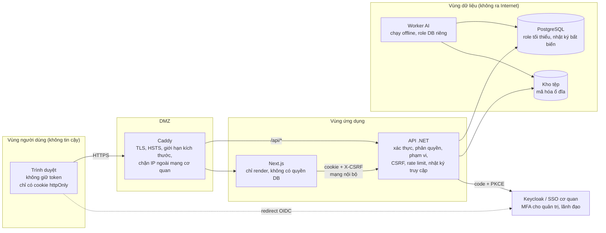

# 05 · Phương án bảo mật

Áp dụng cho toàn hệ thống: trình duyệt, Next.js (`frontend/`), API .NET (`backend/`), PostgreSQL, kho tệp, worker AI Python. Mỗi biện pháp ghi rõ **đã có trong khung** hay **làm ở task nào** (`SEC-*` ở cuối tài liệu, các mã khác ở `docs/tasks/`).

## 1. Căn cứ cần đối chiếu khi triển khai

Danh sách dưới đây để nhóm dự án và bộ phận pháp chế đối chiếu bản hiện hành tại thời điểm triển khai; tài liệu này không thay ý kiến pháp lý.

| Văn bản | Nội dung liên quan |
|---|---|
| Luật An ninh mạng 2018 | Bảo vệ hệ thống thông tin của cơ quan nhà nước |
| Nghị định 85/2016/NĐ-CP và Thông tư 12/2022/TT-BTTTT | Bảo đảm an toàn hệ thống thông tin theo cấp độ; lập hồ sơ đề xuất cấp độ (dự kiến cấp độ 2 hoặc 3, cần xác định khi khảo sát) |
| Luật Bảo vệ dữ liệu cá nhân số 91/2025/QH15 (hiệu lực 01/01/2026) và văn bản hướng dẫn | Hồ sơ công dân (đất đai, thừa kế, hộ tịch) chứa dữ liệu cá nhân: mục đích xử lý, tối thiểu hóa, thông báo khi lộ lọt |
| Nghị định 30/2020/NĐ-CP | Văn thư, lập hồ sơ, nộp lưu; bản lưu không được sửa tùy ý |
| Quy chế bảo đảm an toàn thông tin của UBND thành phố Hà Nội và của phường | Quy định nội bộ về tài khoản, mạng, sao lưu |

## 2. Phân loại dữ liệu

| Mức | Ví dụ | Quy tắc |
|---|---|---|
| **Công khai** | Văn bản đã đăng công khai (`origin = public_source`), danh mục thủ tục | Vẫn cần đăng nhập để xem trong hệ thống; không cần cấp quyền riêng |
| **Nội bộ** (mặc định) | Hồ sơ công việc, tờ trình, biên bản | Xem theo phạm vi phân công |
| **Hạn chế** (`access_level = restricted`) | Hồ sơ có dữ liệu cá nhân của công dân, hồ sơ nhân sự, khiếu nại tố cáo | Cần thêm `document_access_grants` có thời hạn; mọi lần xem/tải ghi nhật ký; không xuất hàng loạt nếu không có duyệt |

Dữ liệu cá nhân nằm ở: ảnh quét, `ocr_pages.text`, `document_field_values`, `ai_field_suggestions`. Cả bốn chỗ đều chịu cùng quy tắc phạm vi như hồ sơ chứa chúng.

## 3. Ranh giới tin cậy

Nguyên tắc: **mọi quyết định cho phép đều nằm ở API**. Next.js ẩn/hiện menu cho dễ dùng, nhưng gọi thẳng API mà không có quyền thì vẫn bị chặn.

## 4. Mối đe dọa chính (STRIDE)

| Mối đe dọa | Ví dụ cụ thể | Biện pháp | Trạng thái |
|---|---|---|---|
| **Giả mạo danh tính** | Đánh cắp phiên, đoán mật khẩu | OIDC + MFA ở IdP; cookie `__Host-` httpOnly Secure; phiên 8 giờ trượt; khóa tài khoản ở IdP | Cookie/OIDC: **có khung**; MFA, khóa: SEC-01 |
| | Tự chọn vai trò Chủ tịch như bản thí điểm | Vai trò lấy từ `user_roles` trên server; header `X-Assignment-Id` được kiểm tra thuộc người dùng | BE-13 |
| **Sửa trái phép** | Sửa trường đã đối chiếu, sửa hồ sơ đã lưu trữ | Chuyển bước chỉ qua `transition_dossier`; hồ sơ `archived` khóa sửa; `row_version` chống ghi đè | DB có sẵn; BE-67 |
| | CSRF: trang lạ gửi form chuyển bước | SameSite=Lax + header `X-CSRF` hoặc Origin trùng | **Có khung** (`CsrfMiddleware`) |
| **Chối bỏ** | “Tôi không trả hồ sơ đó” | `workflow_events`, `audit_events` (actor + correlation id), `access_events` chỉ ghi thêm; role DB của API không UPDATE/DELETE được | Trigger có sẵn; DB-16 |
| **Lộ thông tin** | Xem hồ sơ ngoài phạm vi qua đoán id | `IScopeFilter` ở mọi truy vấn; ngoài phạm vi trả 404, không tiết lộ tồn tại | BE-15 |
| | Lỗi trả stack trace | `GlobalExceptionHandler` chỉ trả mã lỗi; Next production che thông điệp lỗi máy chủ | **Có khung** |
| | Dữ liệu cá nhân trong log | Danh sách trường cấm log, lọc khóa nhạy cảm | **Có khung** (`log.ts`), SEC-07 |
| | Cache dữ liệu người này cho người khác | Tắt `cacheComponents`; API trả `Cache-Control: no-store` | **Có khung** |
| **Từ chối dịch vụ** | Tải lên hàng loạt tệp lớn | Giới hạn 200 MB/tệp, 3 tệp đồng thời/người, 300 request/phút/người | **Có khung** (rate limit) |
| | PDF độc làm treo worker | Worker có timeout, chạy tiến trình riêng, giới hạn số trang | AI-02, SEC-05 |
| **Leo thang quyền** | Quản trị kỹ thuật đọc nội dung hồ sơ | `technical_admin` không có quyền `dossier.*`, `document.*`; `scope_matches` loại trừ | **Có khung** (quyền mặc định) |
| | Mã độc trong PDF chạy trong trình duyệt | pdf.js `isEvalSupported: false`; tải tệp với `Content-Disposition: attachment`; CSP chặt | FE-22, BE-43 |
| | Nội dung tài liệu điều khiển mô hình AI | Prompt bọc tài liệu là dữ liệu; đầu ra ràng theo danh sách trường; kiểm tra trích dẫn có trong văn bản | Có trong `classify.py`; AI-05 |

## 5. Biện pháp theo lớp

### 5.1 Danh tính và phiên

- **Nhà cung cấp danh tính:** Keycloak (dev) hoặc SSO của cơ quan. Hệ thống không lưu mật khẩu.
- **Xác thực hai lớp** bắt buộc cho `technical_admin`, `chair`, `council`, người có `admin.users`; khuyến nghị cho mọi người (SEC-01).
- **Cookie phiên:** `__Host-hoso`, `HttpOnly`, `Secure`, `SameSite=Lax`, `Path=/`, hết hạn 8 giờ, gia hạn khi đang dùng. Dev dùng `hoso_session_dev` không Secure.
- **Lưu phiên phía máy chủ** (`ITicketStore` trong PostgreSQL, BE-12): cookie chỉ chứa khóa; thu hồi phiên ngay khi khóa tài khoản hoặc kết thúc phân công.
- **Đăng xuất:** POST, xóa cookie, kết thúc phiên ở IdP.
- **Không có tài khoản dùng chung.** Tài khoản giả lập chỉ tồn tại khi `Auth:Mode=Dev` và môi trường Development; API từ chối khởi động nếu bật Dev ở môi trường khác (**có khung**).

### 5.2 Phân quyền

Ba lớp kiểm tra, theo thứ tự:

1. **Quyền theo vai trò:** policy động `perm:dossier.read|…` trên từng endpoint (**có khung**, `PermissionAuthorization.cs`). Mặc định mọi endpoint cần đăng nhập (`FallbackPolicy`).
2. **Phạm vi theo phân công:** tổ chức, đơn vị, người được giao, thời hạn, ủy quyền (BE-13, BE-15; DB `scope_matches`).
3. **Mức tiếp cận tài liệu:** `restricted` cần thêm cấp quyền riêng (BE-15, DB-04).

Tách nhiệm vụ: người số hóa không tự duyệt chất lượng của mình (cấu hình ở `workflow_definitions`, DB-10).

### 5.3 Ứng dụng web

| Biện pháp | Ở đâu | Trạng thái |
|---|---|---|
| CSP có nonce, `strict-dynamic`, `frame-ancestors 'none'` | `frontend/src/proxy.ts` | **Có khung** |
| `X-Content-Type-Options`, `X-Frame-Options`, `Referrer-Policy`, `Permissions-Policy`, tắt `X-Powered-By` | `frontend/next.config.ts`, `SecurityHeadersMiddleware` | **Có khung** |
| Chống CSRF | `CsrfMiddleware` (API); Server Actions của Next tự kiểm tra Origin | **Có khung** |
| Chống open redirect (`?tiep=`, `returnUrl`) | `safeReturnTo`, `AuthEndpoints.SafeReturnUrl` | **Có khung**, có test |
| Không dùng `dangerouslySetInnerHTML`; React tự escape | Quy ước code, lint | SEC-04 |
| Kiểm tra đầu vào: FluentValidation ở API, kiểu ngày/số theo `field_definitions` | BE-10, BE-49 | Task |
| Giới hạn tần suất, kích thước | Rate limiter API; Caddy giới hạn body | **Có khung**; OPS-02 |
| Không bật CORS (frontend và API cùng origin) | Caddy | **Có khung** (không cấu hình CORS) |

### 5.4 Tệp tải lên

1. Kiểm tra magic bytes `%PDF-`, không tin `Content-Type` hay đuôi tệp.
2. Giới hạn 200 MB và số trang (cấu hình, mặc định 500).
3. Lưu theo SHA-256, tên tệp gốc chỉ là dữ liệu, không bao giờ dùng làm đường dẫn (**có khung**: `LocalFileStorage` chặn khóa sai dạng).
4. Quét virus bằng ClamAV trước khi đưa vào hàng đợi đọc (SEC-05).
5. Trả tệp với `Content-Type` đúng, `X-Content-Type-Options: nosniff`, `Content-Disposition: attachment` khi tải.
6. Trình xem pdf.js tắt `eval`, không chạy JavaScript trong PDF.

### 5.5 Dữ liệu và hạ tầng

- **Mã hóa đường truyền:** HTTPS ngoài; giữa các máy chủ nội bộ dùng TLS cho PostgreSQL (`sslmode=verify-full`) khi khác máy.
- **Mã hóa lưu trữ:** mã hóa ổ đĩa (LUKS) cho DB, kho tệp, bản sao lưu; bản sao lưu ngoài địa điểm mã hóa bằng khóa riêng (OPS-03).
- **Tài khoản PostgreSQL tối thiểu** (DB-16): `hoso_migrator` (DDL), `hoso_api` (DML, không sửa/xóa bảng nhật ký), `hoso_ai_worker` (chỉ bảng nhóm F), `hoso_readonly` (báo cáo). Không dùng `postgres` cho ứng dụng.
- **Bí mật:** biến môi trường hoặc Docker secrets; không nằm trong git (`.gitignore` đã chặn `.env.local`, `appsettings.*.local.json`). Đổi khóa định kỳ 6 tháng và ngay khi có người nghỉ việc.
- **Mạng:** DB và worker AI không có đường ra Internet; chỉ Caddy mở cổng 443 trong mạng cơ quan; SSH bằng khóa, chỉ từ máy quản trị.
- **Cập nhật:** vá hệ điều hành hằng tháng; cập nhật gói theo cảnh báo bảo mật trong 7 ngày với mức nghiêm trọng cao.

### 5.6 Chuỗi cung ứng

- Khóa phiên bản: `package-lock.json`, `Directory.Packages.props`, `requirements.lock.txt`; ảnh Docker ghim theo digest khi triển khai.
- CI chạy `npm audit --omit=dev`, `dotnet list package --vulnerable`, `pip-audit`; chặn merge khi có lỗ hổng mức cao (SEC-03).
- Hiện có 7 cảnh báo mức trung bình của `npm audit`, đều nằm ở bộ lint `@typescript-eslint` (chỉ dùng khi phát triển, không vào bản build); theo dõi bản sửa ở SEC-03.
- Mô hình AI ghim revision và kiểm SHA-256 theo `download-receipt.json` (đã có).
- Sinh SBOM (CycloneDX) cho mỗi bản phát hành.

### 5.7 AI cục bộ

- Mô hình chạy offline (`HF_HUB_OFFLINE=1`), máy AI không có đường ra Internet.
- Nội dung tài liệu luôn nằm trong khối `<DOCUMENT>` và được ghi rõ là dữ liệu; mô hình chỉ trả JSON theo danh sách trường; trích dẫn phải có thật trong văn bản (`quote_verified`).
- Kết quả AI luôn `needs_review = true`; không có đường nào để AI tự chuyển bước hồ sơ.

## 6. Phát hiện và ứng phó sự cố

**Cảnh báo bảo mật** (cấu hình ở OPS-05, chi tiết ở `06-log-va-giam-sat.md`):

| Dấu hiệu | Ngưỡng gợi ý | Ý nghĩa |
|---|---|---|
| Đăng nhập thất bại | > 10 lần / 5 phút / tài khoản | Đoán mật khẩu |
| 403/404 ngoài phạm vi | > 30 lần / 10 phút / người | Dò id hồ sơ |
| Tải tệp | > 200 tệp / giờ / người | Thu thập hàng loạt |
| Xuất dữ liệu | Gói > 5 GB hoặc ngoài giờ làm việc | Rò rỉ dữ liệu |
| Thay đổi phân công, ủy quyền | Mọi thay đổi | Rà soát định kỳ |
| `csrf_failed` | > 5 lần / giờ | Bị tấn công CSRF hoặc lỗi cấu hình |

**Quy trình ứng phó:**

1. **Phát hiện:** cảnh báo hoặc người dùng báo kèm mã lỗi hoặc mã tương quan.
2. **Cô lập:** khóa tài khoản ở IdP, thu hồi phiên, chặn IP ở Caddy.
3. **Điều tra:** tra Loki theo mã tương quan; xem `access_events`, `audit_events`.
4. **Báo cáo:** thông báo theo đúng thời hạn quy định nếu có lộ lọt dữ liệu cá nhân.
5. **Khôi phục:** khôi phục từ bản sao lưu, rồi rút kinh nghiệm.

Sổ tay chi tiết: SEC-08.

## 7. Kiểm thử bảo mật

| Loại | Công cụ | Khi nào |
|---|---|---|
| Ma trận quyền tự động: 6 vai trò × mọi endpoint × trong/ngoài phạm vi | xUnit + Testcontainers | Mỗi lần merge (QA-01) |
| Kiểm thử bảo mật API (401, 403, CSRF, open redirect) | `SecurityTests.cs` | **Có khung**, mỗi lần merge |
| Phân tích mã tĩnh | CodeQL hoặc Semgrep | Mỗi lần merge (SEC-03) |
| Quét lỗ hổng phụ thuộc | npm audit, dotnet, pip-audit | Mỗi lần merge + hằng tuần |
| Quét động | OWASP ZAP baseline trên môi trường staging | Hằng tuần (SEC-06) |
| Kiểm thử xâm nhập | Đơn vị độc lập | Trước khi đưa vào vận hành và hằng năm |

## 8. Task bảo mật

| ID | Task | Tiêu chí chấp nhận | Phụ thuộc | Ngày |
|---|---|---|---|---|
| SEC-01 | Cấu hình Keycloak: chính sách mật khẩu, khóa sau 10 lần sai, MFA (TOTP) bắt buộc cho quản trị và lãnh đạo, phiên SSO 8 giờ | Xuất realm JSON có các chính sách; thử đăng nhập quản trị không MFA bị từ chối | P0-04 | 1 |
| SEC-02 | Lưu phiên phía máy chủ (`ITicketStore` PostgreSQL), thu hồi phiên khi khóa tài khoản hoặc kết thúc phân công | Khóa tài khoản → request tiếp theo 401 | BE-12 | 1,5 |
| SEC-03 | CI bảo mật: CodeQL/Semgrep, npm audit, `dotnet list package --vulnerable`, pip-audit, SBOM CycloneDX | Pipeline đỏ khi có lỗ hổng mức cao | P0-06 | 1 |
| SEC-04 | Quy tắc lint: cấm `dangerouslySetInnerHTML`, `eval`; cấm import `server-only` vào client; kiểm tra `"use server"` luôn gọi `requireSession` | ESLint báo lỗi khi vi phạm | FE-01 | 0,5 |
| SEC-05 | ClamAV quét tệp tải lên trước khi xếp hàng đọc; giới hạn số trang; timeout worker | Tệp EICAR bị chặn, ghi lỗi rõ cho người dùng | BE-41, AI-02 | 1,5 |
| SEC-06 | OWASP ZAP baseline tự động trên staging, báo cáo HTML | Không có cảnh báo mức cao | OPS-02 | 1 |
| SEC-07 | Kiểm thử không lộ dữ liệu cá nhân trong log: chạy luồng mẫu, quét log tìm số CCCD, tên trong bộ test | Không tìm thấy | LOG-03 | 0,5 |
| SEC-08 | Sổ tay ứng phó sự cố và hồ sơ đề xuất cấp độ an toàn thông tin | Tài liệu được bộ phận phụ trách duyệt | QA-04 | 2 |
