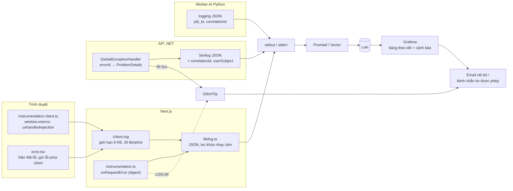
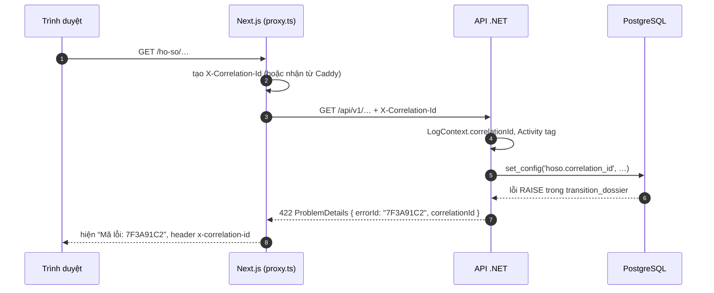

# 06 · Ghi log, báo lỗi và giám sát

Mục tiêu:

1. Người dùng gặp lỗi chỉ cần gửi **một mã**; quản trị tìm ra toàn bộ đường đi của request đó trong vài giây.
2. Lỗi hệ thống được **báo ngay** cho người trực, không chờ người dùng phản ánh.
3. Không ghi nội dung giấy tờ hay dữ liệu cá nhân vào log kỹ thuật.
4. Mọi thứ chạy **trong mạng cơ quan**: không gửi log hay lỗi ra dịch vụ bên ngoài.

## 1. Bốn loại nhật ký, bốn mục đích

| Loại | Lưu ở đâu | Dùng để | Ai xem | Giữ bao lâu |
|---|---|---|---|---|
| **Log kỹ thuật** (JSON một dòng) | stdout → Promtail/Vector → **Loki** | Tra lỗi, đo hiệu năng | Quản trị kỹ thuật | 90 ngày |
| **Lỗi** (exception kèm stack, gom nhóm) | **GlitchTip** (tự cài, tương thích Sentry SDK) | Báo ngay lỗi mới, đếm số lần lặp | Quản trị kỹ thuật, đội phát triển | 90 ngày |
| **Nhật ký nghiệp vụ** | PostgreSQL: `workflow_events`, `audit_events`, `access_events` | Ai làm gì, khi nào; kiểm toán; giải quyết tranh chấp | Lãnh đạo, quản trị (màn Nhật ký hệ thống) | Theo quy định lưu trữ; đề xuất tối thiểu 12 tháng trực tuyến, sau đó lưu trữ |
| **Số đo, trace** | OpenTelemetry → Prometheus/Tempo (hoặc chỉ Prometheus) | Biểu đồ, cảnh báo ngưỡng | Quản trị kỹ thuật | 30 ngày |

Log kỹ thuật **không thay** nhật ký nghiệp vụ: log có thể bị xoay vòng hoặc xóa; nhật ký nghiệp vụ nằm trong DB, chỉ ghi thêm.

## 2. Đường đi của log và lỗi



## 3. Một mã để truy toàn bộ request



| Mã người dùng thấy | Sinh ở | Tra ở |
|---|---|---|
| `errorId` (8 ký tự hex, ví dụ `7F3A91C2`) | `GlobalExceptionHandler` của API | Loki: `{service="hoso-api"} \|= "7F3A91C2"`; GlitchTip tag `error_id` |
| `digest` (lỗi render Next) | Next.js | Loki: `{service="hoso-web"} \| json \| digest="…"` |
| `correlationId` (UUID, trong header và ProblemDetails) | `proxy.ts` hoặc `CorrelationIdMiddleware` | Tất cả dịch vụ; cột `hoso.correlation_id` khi ghi audit (LOG-05) |

## 4. Định dạng log

Một dòng JSON mỗi sự kiện. Tên sự kiện dạng `snake_case`, là danh từ hoặc quá khứ: `http_request`, `request_rejected`, `unhandled_exception`, `job_completed`, `client_error`.

| Trường | Ví dụ | Bắt buộc |
|---|---|---|
| `ts` / `@t` | `2026-11-16T02:14:09.115Z` | Có |
| `level` / `@l` | `error` | Có |
| `service` | `hoso-web`, `hoso-api`, `hoso-ai-worker` | Có |
| `env` | `production` | Có |
| `event` / `@mt` | `request_failed` | Có |
| `correlationId` | `4ecc…` | Có khi có request |
| `userSubject`, `assignment` | `mau.tp.ht`, `a-tp-ht` | Khi đã đăng nhập |
| `path`, `method`, `status`, `elapsedMs` | `/api/v1/dossiers`, `GET`, `200`, `45` | Log HTTP |
| `errorId`, `errorCode`, `digest` | `7F3A91C2`, `dossier_incomplete` | Log lỗi |
| `exception` / `@x` | stack trace | Lỗi 5xx |

Ví dụ thật từ khung frontend khi chạy thử:

```json
{"ts":"2026-11-16T02:14:09.115Z","level":"error","service":"hoso-web","env":"development","event":"client_error","kind":"error","message":"Thử lỗi","path":"/ho-so","correlationId":"4eccad7f-…","userAgent":"curl/8.7.1"}
```

## 5. Mức log

| Mức | Khi nào | Ví dụ |
|---|---|---|
| `Error` | Cần người xử lý | Exception chưa bắt, DB không kết nối, job AI lỗi hết số lần thử |
| `Warning` | Bất thường nhưng hệ thống vẫn đúng | Request bị từ chối (4xx), request chậm hơn 2 giây (dòng `slow_request`, ngưỡng `Observability:SlowRequestMs`), CSRF bị chặn |
| `Information` | Sự kiện vận hành | Mỗi request HTTP (một dòng), khởi động, migration, job xong |
| `Debug` | Chỉ khi điều tra, tắt ở production | Câu SQL, gọi API thành công từ Next |

## 6. Không được ghi vào log kỹ thuật

- Nội dung giấy tờ, văn bản OCR, giá trị trường (tên, số CCCD, địa chỉ, số thửa).
- Từ khóa tìm kiếm (thường chứa tên người): chỉ ghi độ dài và số kết quả.
- Cookie, token, header `Authorization`, mật khẩu, khóa bí mật.
- Thân request/response. Serilog chỉ ghi `RequestPath`, không ghi query string.

Cách thực thi:

- `frontend/src/lib/log.ts` thay giá trị các khóa nhạy cảm bằng `[đã ẩn]` (**có khung**).
- GlitchTip đặt `SendDefaultPii = false`, `MaxRequestBodySize = None` (**có khung**).
- Kiểm thử SEC-07 quét log của luồng mẫu để tìm dữ liệu cá nhân.

## 7. Cảnh báo

| Cảnh báo | Điều kiện | Mức | Gửi tới |
|---|---|---|---|
| Lỗi mới | GlitchTip thấy nhóm lỗi chưa từng có | Cao | Đội phát triển |
| Tỷ lệ lỗi 5xx | > 1% request trong 5 phút | Cao | Trực vận hành |
| API không sẵn sàng | `/health/ready` lỗi 2 lần liên tiếp | Khẩn | Trực vận hành |
| Hàng đợi AI treo | Job `running` không có heartbeat > 15 phút, hoặc hàng đợi > 50 | Trung bình | Quản trị kỹ thuật |
| Đọc PDF lỗi | > 20% job lỗi trong 1 giờ | Trung bình | Quản trị kỹ thuật |
| Sao lưu | Lần thành công gần nhất cách > 26 giờ (chỉ số `hoso.backup.last_success_age_hours{kind}` và `hoso.backup.healthy`; API cũng tự báo quản trị kỹ thuật, BE-89) | Cao | Trực vận hành |
| Dung lượng | Ổ DB hoặc kho tệp > 80% | Trung bình | Trực vận hành |
| Bảo mật | Các ngưỡng ở `05-bao-mat.md` mục 6 | Cao | Phụ trách an toàn thông tin |
| Request chậm | p95 > 1 giây trong 15 phút | Thấp | Đội phát triển |

Mỗi cảnh báo có đường dẫn tới bảng Grafana hoặc nhóm lỗi GlitchTip và một dòng “làm gì tiếp” trong sổ tay vận hành (OPS-06).

## 8. Bảng theo dõi (Grafana)

1. **Tổng quan dịch vụ:** request/phút, tỷ lệ lỗi, p50/p95 thời gian phản hồi theo endpoint.
2. **AI:** độ dài hàng đợi, thời gian đọc mỗi trang, tỷ lệ trang đọc lỗi, tỷ lệ gợi ý được chấp nhận nguyên (`v_ai_accuracy`).
3. **Nghiệp vụ:** hồ sơ theo trạng thái, hồ sơ quá hạn, PDF chờ xếp, số đợt nộp lưu.
4. **Bảo mật:** đăng nhập thất bại, 403 theo người dùng, khối lượng tải và xuất.
5. **Hạ tầng:** CPU, RAM, dung lượng, kết nối DB, lần sao lưu gần nhất.

## 9. Đã có trong khung

| Thành phần | Tệp |
|---|---|
| Mã tương quan, CSP nonce | `frontend/src/proxy.ts`, `backend/src/HoSoSo.Api/Middleware/CorrelationIdMiddleware.cs` |
| Log JSON phía Next, lọc khóa nhạy cảm | `frontend/src/lib/log.ts` |
| Bắt lỗi máy chủ Next (`onRequestError`) | `frontend/src/instrumentation.ts` |
| Bắt lỗi trình duyệt và nhận lỗi | `frontend/src/instrumentation-client.ts`, `frontend/src/app/client-log/route.ts` |
| Màn lỗi có Mã lỗi và nút Thử lại | `frontend/src/components/ui/error-panel.tsx`, `app/(app)/error.tsx`, `app/global-error.tsx` |
| Log lỗi khi gọi API kèm mã | `frontend/src/lib/api/server.ts` |
| Serilog JSON, log HTTP một dòng | `backend/src/HoSoSo.Api/Observability/ObservabilitySetup.cs`, `Program.cs` |
| ProblemDetails + errorId, chuyển lỗi PL/pgSQL thành mã nghiệp vụ | `backend/src/HoSoSo.Api/Errors/GlobalExceptionHandler.cs` |
| GlitchTip (bật khi có DSN), OpenTelemetry (bật khi có OTLP endpoint) | `ObservabilitySetup.cs` |
| Ghi người thao tác và mã tương quan vào phiên DB | `backend/src/HoSoSo.Infrastructure/Persistence/Interceptors/ActorContextInterceptor.cs` |

## 10. Task ghi log và giám sát

| ID | Task | Tiêu chí chấp nhận | Phụ thuộc | Ngày |
|---|---|---|---|---|
| LOG-01 | Dựng Loki + Promtail (hoặc Vector) + Grafana bằng compose profile `observability`; gom stdout của 3 dịch vụ | Tìm được một `correlationId` trên cả `hoso-web` và `hoso-api` | OPS-02 | 1,5 |
| LOG-02 | Dựng GlitchTip, tạo 3 dự án (web, api, ai-worker), đặt DSN qua biến môi trường | Ném lỗi thử ở API → có nhóm lỗi trong GlitchTip kèm `error_id` | OPS-02 | 1 |
| LOG-03 | Worker Python: log JSON cùng định dạng, gắn `job_id`, `correlation_id` (lấy từ `ocr_jobs.options`) | Truy được job AI từ mã tương quan của lần tải lên | AI-02 | 1 |
| LOG-04 | Next.js gửi lỗi máy chủ sang GlitchTip (`@sentry/nextjs` trỏ DSN nội bộ, chỉ bật khi có DSN) | Lỗi render có digest xuất hiện trong GlitchTip | LOG-02 | 1 |
| LOG-05 | Thêm `correlation_id` vào `audit_events` (đọc `hoso.correlation_id` trong trigger) | Thay đổi hồ sơ tra được ngược về request | DB-13 | 0,5 |
| LOG-06 | Ghi `access_events` (xem, tải, in, xuất, tìm kiếm) ở nền, không chặn request | Tải tệp tạo đúng 1 dòng; mất DB tạm thời không làm lỗi request | BE-16 | 1 |
| LOG-07 | 5 bảng Grafana và các cảnh báo ở mục 7, kèm liên kết sổ tay | Tắt worker AI → cảnh báo hàng đợi treo sau 15 phút | LOG-01 | 2 |
| LOG-08 | Màn “Nhật ký hệ thống”: lọc theo người, hành động, thời gian, mã tương quan; tìm theo Mã lỗi người dùng gửi | Nhập mã lỗi ra đúng request và người | BE-88, FE-44 | 1,5 |
