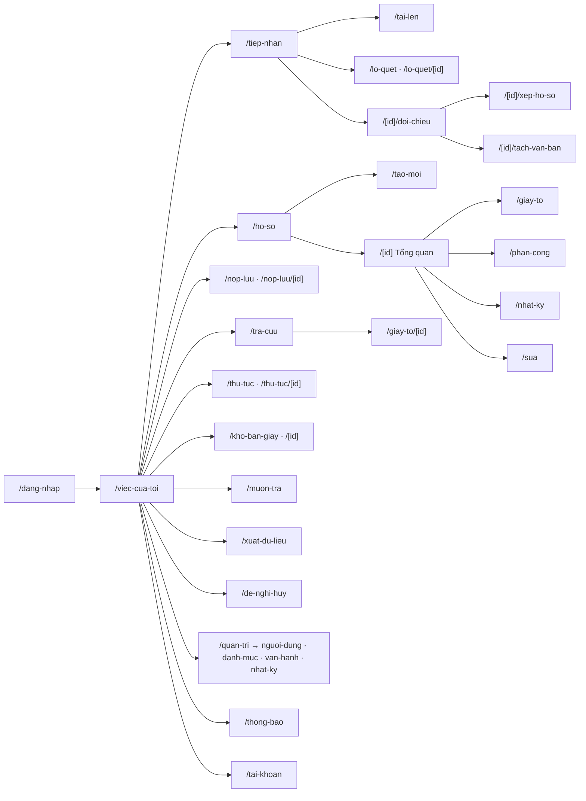

# 07 · Khung đường dẫn và giao diện

Khung đã dựng trong `frontend/` (Next.js 16): 36 đường dẫn trang, menu theo quyền, ô Đi nhanh, trang lỗi, trang không có quyền. Tài liệu này là quy ước để mọi màn mới làm giống nhau.

Chạy thử khung với dữ liệu giả lập:

```sh
cd frontend
cp .env.example .env.local     # HOSO_MOCK=1
npm run dev                    # http://localhost:3000 → chọn một tài khoản mẫu
```

## 1. Ba nguyên tắc

| Nguyên tắc | Cụ thể trong khung |
|---|---|
| **Dễ dùng:** mở ra là thấy việc của mình | Trang gốc chuyển thẳng tới **Việc của tôi**, nội dung theo vai trò; vai trò lấy từ tài khoản, không chọn tay; menu chỉ hiện mục có quyền |
| **Dễ nhìn:** cùng một bố cục ở mọi màn | Breadcrumb → tiêu đề → một câu mô tả → thao tác bên phải; trạng thái luôn có chữ, không chỉ dựa vào màu; tối đa 5 mục mỗi nhóm menu |
| **Dễ thao tác:** ít bước, có phím tắt, không mất việc | Nút chính luôn ở góc phải; tab và bộ lọc là đường dẫn thật; Ctrl+K đi nhanh; luồng tiếp nhận 3 bước có “Lưu và mở PDF tiếp theo”; lỗi có nút Thử lại và mã lỗi |

## 2. Bản đồ đường dẫn

Quy tắc đặt tên: **tiếng Việt không dấu, chữ thường, nối bằng gạch ngang**; danh từ ở cấp 1, hành động hoặc tab ở cấp dưới; id là UUID. Luôn tạo đường dẫn bằng `src/config/routes.ts`, không viết chuỗi tay.



| Đường dẫn | Màn hình | Quyền cần (một trong) | Task |
|---|---|---|---|
| `/dang-nhap` | Đăng nhập tài khoản cơ quan; chế độ giả lập hiện tài khoản mẫu | Công khai | FE-05 |
| `/` | Chuyển tới Việc của tôi | Đăng nhập | — |
| `/viec-cua-toi` | Hàng việc theo vai trò, số PDF chờ đối chiếu | Đăng nhập | FE-20 |
| `/tiep-nhan` | Hộp tiếp nhận; lọc `?trang-thai=cho-xep\|da-xep\|da-bo` | `intake.upload` (API của hộp tiếp nhận chỉ nhận quyền này) | FE-21 |
| `/tiep-nhan/tai-len` | Bước 1 · Nạp PDF | `intake.upload` | FE-21 |
| `/tiep-nhan/lo-quet`, `/tiep-nhan/lo-quet/[batchId]` | Lô quét, lỗi ảnh | `intake.manage`, `intake.upload` | FE-41 |
| `/tiep-nhan/[documentId]/doi-chieu` | Bước 2 · Đối chiếu (màn chia đôi) | `document.edit` | FE-22, FE-23 |
| `/tiep-nhan/[documentId]/xep-ho-so` | Bước 3 · Xếp vào hồ sơ | `dossier.prepare` | FE-24 |
| `/tiep-nhan/[documentId]/tach-van-ban` | Tách một tệp thành nhiều văn bản | `document.edit` | FE-25 |
| `/ho-so` | Danh sách hồ sơ; lọc `?q=&trang-thai=` | `dossier.read` | FE-26 |
| `/ho-so/tao-moi` | Tạo hồ sơ | `dossier.prepare` | FE-27 |
| `/ho-so/[id]` | Tổng quan: danh sách kiểm tra đủ thành phần, thông tin, vị trí bản giấy | `dossier.read` | FE-28 |
| `/ho-so/[id]/giay-to` | Giấy tờ trong hồ sơ | `dossier.read` | FE-29 |
| `/ho-so/[id]/phan-cong` | Giao người chủ trì, hạn (tab chỉ hiện với trưởng phòng) | `dossier.assign` | FE-31 |
| `/ho-so/[id]/nhat-ky` | Nhật ký xử lý | `dossier.read` | FE-32 |
| `/ho-so/[id]/sua` | Sửa thông tin | `dossier.prepare` | FE-27 |
| `/nop-luu`, `/nop-luu/[submissionId]` | Hàng chờ và các đợt nộp lưu | `dossier.archive` | FE-37 |
| `/tra-cuu` | Tra cứu; `?q=` | `document.view` | FE-34 |
| `/giay-to/[id]` | Chi tiết giấy tờ | `document.view` | FE-33 |
| `/thu-tuc`, `/thu-tuc/[id]` | Thủ tục hành chính | Đăng nhập | FE-35 |
| `/kho-ban-giay`, `/kho-ban-giay/[locationId]` | Kho, tủ, kệ, hộp | `storage.manage` | FE-36 |
| `/muon-tra` | Mượn trả hồ sơ giấy | `loan.request`, `loan.approve` | FE-36 |
| `/xuat-du-lieu` | Gói bàn giao | `export.create` | FE-38 |
| `/de-nghi-huy` | Đề nghị hủy | `disposal.request`, `disposal.approve` | FE-39 |
| `/thong-bao` | Thông báo | Đăng nhập | FE-40 |
| `/tai-khoan` | Tài khoản, phân công | Đăng nhập | FE-42 |
| `/quan-tri` | Chuyển tới mục quản trị đầu tiên được phép | Một quyền quản trị | — |
| `/quan-tri/nguoi-dung`, `/quan-tri/nguoi-dung/[id]` | Người dùng, phân công, ủy quyền | `admin.users` | FE-42 |
| `/quan-tri/danh-muc` | Danh mục hồ sơ, loại giấy tờ, trường | `catalog.manage` | FE-43 |
| `/quan-tri/van-hanh` | Hàng đợi AI, sao lưu, cài đặt | `processing.manage`, `admin.settings` | FE-44 |
| `/quan-tri/nhat-ky` | Nhật ký hệ thống | `admin.settings` | LOG-08 |

## 3. Bố cục một màn

```
┌──────────────┬─────────────────────────────────────────────────────────────────┐
│ UBND · HĐND  │ [☰] [🔍 Tìm số ký hiệu, mã hồ sơ…]   [⌘ Đi nhanh Ctrl K] [🔔 2]   │
│ Hồ sơ số     │                                   [Phân công ▾] [Tên] [⎋]       │
│              ├─────────────────────────────────────────────────────────────────┤
│ CÔNG VIỆC    │ Hồ sơ › DEMO-2026-0002                       ← breadcrumb       │
│ ▌Việc của tôi│ Hồ sơ kiểm tra môi trường…                   [Sửa thông tin]    │
│  Tiếp nhận 1 │ DEMO-2026-0002 · [Yêu cầu bổ sung] · Hạn 28/11  ← meta          │
│  Hồ sơ       ├─────────────────────────────────────────────────────────────────┤
│ TRA CỨU      │ Tổng quan | Giấy tờ 4 | Phân công | Nhật ký   ← tab = đường dẫn │
│  Tra cứu     ├─────────────────────────────────────────────────────────────────┤
│  Thủ tục     │                                                                 │
│ KHO & BÀN…   │   Nội dung tab                                                  │
│              │                                                                 │
│              ├─────────────────────────────────────────────────────────────────┤
│              │ Chưa trình được: còn 2 thành phần…      [Trình trưởng phòng]    │
└──────────────┴─────────────────────────────────────────────────────────────────┘
                 ↑ thanh thao tác dính đáy, chỉ có nút API cho phép
```

- **Sidebar** rộng 256px từ 1024px trở lên; màn hẹp hơn thành ngăn kéo mở bằng nút ☰.
- **Thanh trên** dính đầu trang; ô tìm gửi `GET /tra-cuu?q=`.
- **Vùng nội dung** có `id="noi-dung"`; phím Tab đầu tiên hiện liên kết “Bỏ qua menu, đến nội dung”.

## 4. Thành phần dùng chung

| Thành phần | Tệp | Dùng khi |
|---|---|---|
| `AppShell` | `components/layout/app-shell.tsx` | Mọi màn sau đăng nhập (đặt trong `app/(app)/layout.tsx`) |
| `NavList`, `MobileNav` | `components/layout/nav-list.tsx`, `mobile-nav.tsx` | Menu; đọc từ `config/navigation.ts` |
| `CommandPalette` | `components/layout/command-palette.tsx` | Ctrl+K hoặc `/`: gõ không dấu, Enter để mở; gõ mã thì tìm trong Tra cứu |
| `AssignmentSwitcher` | `components/layout/assignment-switcher.tsx` | Người có nhiều phân công |
| `PageHeader` | `components/ui/page-header.tsx` | Đầu mọi trang |
| `TabsNav` | `components/ui/tabs-nav.tsx` | Tab là đường dẫn (trang hồ sơ) |
| `Stepper` | `components/ui/stepper.tsx` | Luồng nhiều bước (tiếp nhận) |
| `ActionBar` | `components/dossier/action-bar.tsx` | Thao tác chuyển bước; ô ý kiến mở ngay cạnh nút, đếm đủ 10 ký tự |
| `Section`, `EmptyState`, `PageBody` | `components/ui/blocks.tsx` | Khối nội dung, trạng thái rỗng |
| `Chip`, `WorkflowChip` | `components/ui/status-chip.tsx` | Trạng thái: luôn có chữ |
| `Button`, `ButtonLink` | `components/ui/button.tsx` | Nút; `variant="primary"` chỉ một nút mỗi vùng |
| `NoAccess` | `components/ui/no-access.tsx` | Phân công không có quyền: nói phân công đang dùng, gợi ý đổi |
| `ErrorPanel` | `components/ui/error-panel.tsx` | Lỗi: Mã lỗi, Thử lại, Về Việc của tôi |
| `PlannedScreen`, `ScaffoldPage` | `components/ui/blocks.tsx`, `scaffold-page.tsx` | Chỉ cho khung; xóa khi làm task |

## 5. Quy tắc tương tác

1. **Một nút chính mỗi vùng**, luôn ở góc phải dưới hoặc phải của đầu trang. Hành động phá hủy (Bỏ, Trả lại, Hủy) dùng kiểu viền, không dùng nút chính.
2. **Nút bị khóa luôn có lý do** ngay cạnh hoặc trong `title`: “Chưa trình được: còn 2 thành phần…”.
3. **Không hộp thoại xác nhận chung chung.** Hành động cần ý kiến mở ô ý kiến tại chỗ; hành động không đảo ngược được (hủy tài liệu) xác nhận hai bước trong trang.
4. **Bộ lọc là form GET**: nằm trên URL, chạy cả khi JavaScript chưa tải, gửi đường dẫn được.
5. **Tab là đường dẫn**: mở thẻ mới, Back, chia sẻ đều đúng.
6. **Không mất việc đang làm:** đối chiếu tự lưu nháp; rời trang khi còn thay đổi chưa lưu thì hỏi lại trong trang.
7. **Ngoài phạm vi trả “Không tìm thấy”** (không tiết lộ hồ sơ có tồn tại); không đủ quyền mở cả màn thì hiện `NoAccess`.
8. **Phím tắt:** `Ctrl/⌘ K` hoặc `/` đi nhanh; `Ctrl Enter` sang bước tiếp ở màn đối chiếu; `↑ ↓ Enter` trong danh sách đi nhanh.
9. **Chữ và số:** ngày `dd/mm/yyyy`; số căn phải và `tabular-nums`; mã hồ sơ dùng font đơn cách.
10. **Tiếp cận:** mọi ô nhập có nhãn; trạng thái có chữ; focus luôn thấy; `aria-current` cho menu, tab, bước; kiểm tra bằng axe ở QA-05.

## 6. Thêm một màn mới

1. Thêm đường dẫn vào `src/config/routes.ts`.
2. Nếu là mục menu: thêm vào `src/config/navigation.ts` (nhãn, một câu mô tả, biểu tượng, quyền, từ khóa không dấu).
3. Tạo `src/app/(app)/<duong-dan>/page.tsx`:
   - gọi `pageSession(quyền)`; nếu `allowed=false`, trả `<NoAccess/>`;
   - lấy dữ liệu bằng `serverApi()` (client có kiểu theo `openapi.json`) trong Server Component;
   - bắt đầu bằng `<PageHeader>` có breadcrumb.
4. Ghi dữ liệu bằng Server Action bọc trong `runAction()` (`lib/actions.ts`: kiểm phiên, trả lỗi theo ô) và gọi từ client bằng `useServerAction()`. Chỉ tải tệp lên, ảnh trang và luồng SSE mới gọi thẳng `/api/v1/...` từ trình duyệt, luôn kèm `browserHeaders()` (`X-CSRF: 1` và `X-Assignment-Id`); không dùng `` hay `EventSource` trỏ thẳng vào API vì chúng không gửi được header phân công.
5. Có trạng thái rỗng (`EmptyState`) nói rõ sẽ có gì và cách tạo mục đầu tiên; `loading.tsx` có sẵn ở `(app)`.
6. Chạy `npx tsc --noEmit`, `npm run lint`, `npm run build`.
